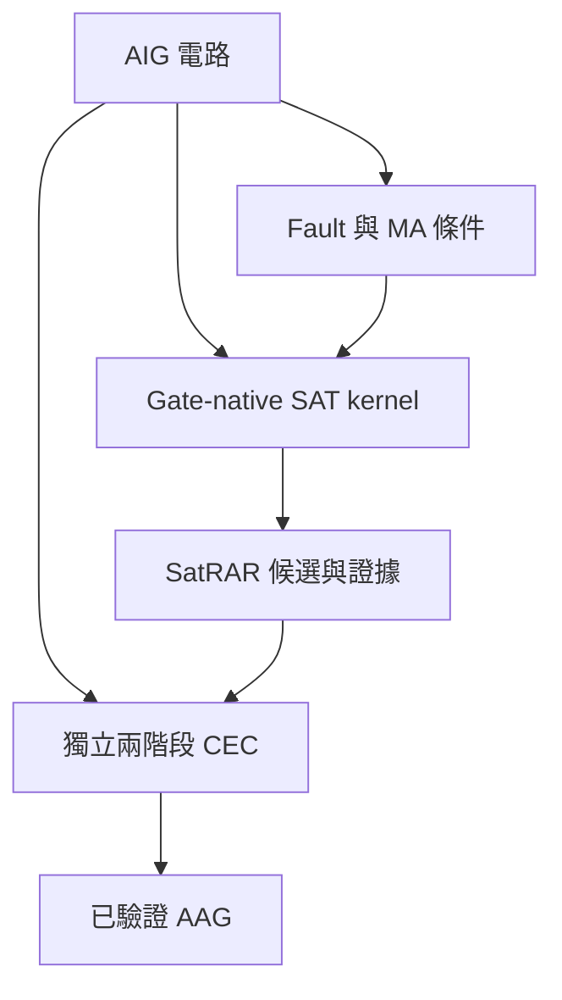

# SatRAR V2 Plan — Circuit-based SAT 架構

2026-11-25 · EdaLab · C++17／CMake／Windows x64 · 新專案 `satrar-circuit-v2/`

## 0. 交給 Claude／Cursor 的任務

在 `C:/Users/User/Documents/file/NTU/EdaLab/satrar-circuit-v2` 建立獨立的 C++ SatRAR 研究專案。**以 AIG 為求解器的主要資料結構，直接在 gate 上做 BCP、理由追蹤與衝突學習**。依 V0–V5 實作及驗收。以現有 `../satrar-cpp` 作為對照來源，逐模組移植 AAG 載入、拓樸及已驗證的改線流程。V2 的原始碼、建置與產出寫入新資料夾。

- **第一個可用版本（V0–V3）** 能在 AIG 上做增量故障推論、以論文的 `MA(w_t)`／`MA(g_d)` 產生替代 wire／gate／AND–OR 子電路，並輸出經兩階段 CEC 驗證的 AAG。
- **求解器版本（V4）** 另提供有界或完整的 SAT／UNSAT 求解，用於 exact fault／MA 診斷。完整搜尋和 RAR trial 各有自己的入口、狀態和預算。SatRAR 維持論文 Figure 5 的受控搜尋。
- **實驗版本（V5）** 在相同 AIG 與設定下對照 V1／V2，跑論文的比較模式，量出 gate-native 傳播對 discovery 時間和記憶體的影響。
- 每個階段交付時須能 configure、build、CTest。附上所用命令、已通過條件、失敗的輸入或設定，以及可以接著工作的程式入口。各階段的草碼及 CLI 名稱如下，可依現有 repo API 調整並記錄。

### 工作基線與論文依據

| 資料 | 使用方式 |
|---|---|
| `../ASPDAC-2009-SatRAR.pdf` | Wu、Lin、Huang、Huang，ASPDAC 2009，印刷頁 191–196。§II 檢查 fault、MA、2-Way RAR；§III 檢查候選定理；§IV Figure 5／6 檢查增量求解；§V 檢查模式與量測。 |
| `../11. Applications of SAT on Logic Syn.pdf` | PDF 第 22–30 頁為 2-Way RAR，第 31–40 頁為 SatRAR。講義版替代 gate 有自己的 fixture 期望值。 |
| `../satrar-cpp/docs/SatRAR_Implementation_Spec.md` | V1 的語意、原論文排版釐清、測試基準和實驗口徑。取成熟的行為契約作 V2 驗收基礎。 |
| `../satrar-cpp/results/PHASE_STATUS.md` | 目前紀錄 Release／Debug 各 22 項通過、Figure 1 八模式 623 筆候選通過兩階段 CEC、12/12 BENCH 輸入已到齊。實作起點重新記錄所使用的 V1 binary 和 fixture hashes。 |
| `../satrar-cpp/src/analysis/CircuitPropagator.cpp` | V1 從 AIG 建構 DIMACS 對應及每 gate 三條規則，以 `enforce()` 傳播，已具備 trail、前綴重用與 `learnNow()`。V2 以 gate adjacency 和 gate reason 取代原電路約束的 clause 掃描。 |

## 1. 分層與目錄

以下為實作完成後的布局。

| 模組 | 責任 | V1 移植決策 |
|---|---|---|
| `src/aig/` | 組合 AIG、signed literal、AAG I/O、模擬、pin 身分 | 移植經測試的 `Circuit`、`Literal`、`WireRef` 與 AAG parser／writer。維持外部 AAG 變數語意，集中編譯到求解器的 dense signal ID。 |
| `src/solver/` | `GateNet`、gate BCP、trail、原生理由、conflict analysis、learned clauses、assumption query、exact search | 寫新 kernel。所有原電路與求解用故障 miter 的約束均由 AIG gate／常數提供。學得條款在同一 trail 上傳播。此層介面使用 circuit literals。 |
| `src/analysis/` | postdominator、affected cone、pin／output fault、fault projection、MA snapshot | 保留 `GraphAnalysis` 契約與 oracle。重寫 V1 `FaultContext` 中的 CNF projection，用 gate-native miter 建立偵測條件。 |
| `src/rar/` | 論文模式、支配點試探、定理理由、candidate key、改線 | 以 V1 `SatRarEngine` 和 fixtures 移植規則，適配新 solver 介面。保留已驗證的 `Rewriter`。 |
| `src/verify/` | 獨立 CEC、model replay、原子輸出 | 移植 V1 `MiterBuilder`、CNF encoder、CaDiCaL backend、`RarVerifier`、`ExportAag`。verification 模組可用 CNF。 |
| `app/` | 讀檔、查 fault、候選搜尋、驗證、寫檔與 batch CLI | 從現有 CLI 中移植使用者已在用的命令。 |
| `tests/`、`tests/fixtures/` | gate truth table、solver 差分、論文 fixture、端到端等價驗證 | 將 V1 的 oracle、Fig. 1／6 與 theorem fixtures 作為驗收資料，標記來源。 |
| `benchmarks/manifests/`、`scripts/`、`results/` | 實驗輸入、分片定位、測試設定和報告 | 適配現有 12 case manifest 和已驗證轉換腳本。開發期可明確引用 V1 的資料路徑，以輸入 hash 固定對照。 |

建置 target 提案為 `satrar_v2_aig`、`satrar_v2_solver`、`satrar_v2_rar`、`satrar_v2_verify`、`satrar_v2`。必要方向為 `solver → aig`、`rar → solver/aig`、`verify → aig`、`CLI → rar/verify`。`satrar_v2_solver` 應可獨立 link 和測試。Windows x64 Release／Debug 均適用，CTest 和 oracle fixtures 跟著實作階段加入。V2 原生 solver 與獨立 verifier 的 CNF 程式碼放在不同建置 target。



## 2. V0／V1｜移植電路模型與原生求解器 kernel

### V0 基線與資料模型

1. 建立 C++17／CMake 專案。移植實際需要的 V1 AIG parser、拓樸、模擬和相應測試，在來源清單記錄來源檔與版本／hash。固定取 Figure 1、Corollary 2.1／2.2、Theorem 3 fixtures。用獨立 build directory 建置 V2，保留 V1 近期結果作對照。
2. `GateNet` 編譯一次，保存原始 signed edge、PI／PO 位置、immutable gate table、dense signal 映射及 signal-to-incident-gates CSR 或向量。每個 gate 在 `out` 和兩個 `fanin` 變數的 incident list 登記。可用同一 immutable net 建多個 `SolverSession`，每個 session 擁有自己的 values、trail、constraints 及 budget。
3. AAG raw `2v+inv`、常數 `0/1` 和內部 dense id 有明確轉換。pin ID 採原電路的 `(receiving gate, pin index)`；即使有 `x∧x`、`x∧¬x` 或常數化簡，ATPG 仍在原 pin 位址注入故障。只在求解約束評估中簡化 gate 的等價關係。

### V1 Gate BCP 與理由

對 raw (z=x\land y) 使用固定成本的局部規則。(x,y) 是可能反相的 literals，先取其邏輯值。

| 已知 | Gate 原生推論 | 可按需重建的 reason |
|---|---|---|
| (x=0) 或 (y=0) | (z=0) | `¬z ∨ x` 或 `¬z ∨ y` |
| (x=y=1) | (z=1) | `z ∨ ¬x ∨ ¬y` |
| (z=1) | (x=1,y=1) | `¬z ∨ x`／`¬z ∨ y` |
| (z=0,x=1) 或 (z=0,y=1) | 對側輸入為 `0` | `z ∨ ¬x ∨ ¬y` |
| (z=0)，兩側均 `X` | 保留未決的 justification | 由 split／decision 解開 |
| 推論要求與現值相反 | 產生 conflict，保留證據 | 衝突規則與觸發指派 |

1. `enqueue(lit, reason)` 同值重複即成功，反值回傳 conflict。使用 trail 與 `qhead`，每筆新指派喚醒相鄰 gate 與相關 learned clauses，直到 BCP fixpoint。先處理常數、`AND(x,x)` 等同 `x`、`AND(x,¬x)` 等同常數 0，再實作完整 signed 規則。這些情況在 root 時也應能正確傳播。回報初始建置 / event 走訪數。
2. Trail entry 保存 literal、level、reason。Reason 可為 root unit、assumption、decision、`GateId + RuleKind` 或 `LearnedClauseId`。出現 collision 時保存兩邊足夠的原因。理由內容須能在撤銷指派前收集，禁止回溯後再讀失效的 trail index。理由重建，用於單元測試、conflict analysis 和候選證據。
3. 以 `pushLevel()`、`mark()`、`rollback()` 和 `setAssumptions(ordered)` 重用前綴。對每次 `probe` 記錄新增 trail 的起點。保留 root 指派、assumption prefix、存活理由和 queue cursor；若 learned rule 在較深層才安裝，回溯正確重播相應 learned unit。可先用冷啟動重播當 oracle，原生 kernel 經差分後再優化。
4. `decisionSupport` 沿 gate／learned reasons 找到真正的 assumption roots 與 probe decisions。若 `C ∧ G ∧ T ⇒ ⊥`，可全域安裝 `∨¬G ∨ ∨¬T`。`G` 是這次實際使用的 fault／context assumptions，`T` 是使用的 trial roots。插入 learned clause 後立即在目前 trail 上做 unit／conflict 檢查。Clause 生命週期依 immutable circuit identity 綁定，trials 共享，獨立 fault run 以 cold baseline 啟動。

```cpp
enum class QueryState { Open, Conflict, Limit };  // bounded BCP probe
enum class SolveState { Sat, Unsat, Unknown };    // exact search

struct GateReason {
    GateId gate;
    GateRule rule;
};

class SolverSession {
public:
    explicit SolverSession(const GateNet& net);
    QueryState setAssumptions(const std::vector<Lit>& ordered);
    Checkpoint mark() const;
    void rollback(Checkpoint point);
    ProbeResult probe(Lit decision, Budget& budget);
    Support explain(Lit implied) const;
    Support explainConflict() const;
    QueryState learnGuarded(const Support& support);
    SolveResult solve(const std::vector<Lit>& assumptions, Budget& budget);
};

QueryState SolverSession::propagate(Budget& budget) {
    while (queueHasPending()) {
        if (!budget.chargeEvent()) return QueryState::Limit;
        const Lit assigned = takePending();
        if (!propagateIncidentGates(assigned.var()) ||
            !propagateLearnedClauses(assigned)) {
            return QueryState::Conflict;
        }
    }
    return QueryState::Open;
}
```

**V1 驗收**。對一個 AND 枚舉 `x,y,z∈{0,1,X}` 的 27 組部分指派，另測特例與反相。再用獨立的 reference CNF BCP 比對相同 gate normalization 的 closure 和衝突；形狀不同的等價推論，用真值表檢查 soundness。為每個 gate reason 驗證「前提加上結論的反面」不可滿足。對相同 assumptions，fresh session 與連續切換、回溯及學習後的對應 session 可重現 closure。斷開 V1 CNF encoder 仍能通過 solver target 測試。

## 3. V2｜fault、MA 與原生差異電路

**論文依據** §II.A、Figure 1、§IV Figure 5／6。

1. `FaultRef::Pin` 使用 named destination 與 receiving pin。`sa=b` 需 good pin 值 `1−b` 以激發，faulty 版只覆蓋那個 pin。`FaultRef::Output` 將 faulty node 的輸出固定，其他消費者依 signed edge 解讀。raw AND 的 controlling stuck 值為 0。若 paper 的 OR 以 complemented AND 表示，需同時顯示邏輯值與 raw 極性。
2. `PostDominatorIndex` 以所有 PO 的共同虛擬 sink 求下游支配點。同一個 target 的優先順序由實際 receiver 往 PO。生成假設時，先按靠近輸出至靠近故障的順序加入穩定的傳播條件，再加當下 excitation 和 trial。擴充 `FaultSnapshot` 保存 ordered assumptions、MA literals、reason reference、fault context status，讓 Fig. 6 層與實際 trail levels 可以對照。
3. 單一受故障影響的 AND fanin 可利用另一個未受影響輸入為 `1` 的必要條件。重匯合時以 native fault miter 視察所有受影響 PO。good view 保留原電路，faulty view 在受影響輸出的 backward cone 內只重建可能受影響的節點，共用 PI 及可證明未受故障影響的節點。以 AIG AND／inverter 組成逐 PO XOR，再 OR 成觀察條件 `D_f`。發出 `D_f=1` 的 assumption，執行 gate BCP。觀察到的 good-view 指派投影回原電路。任何投影 MA 需 `D_f ⇒ literal`，且只能作帶 fault context 的前提。
4. 提供三種有意義的結果。BCP conflict 為故障條件已被反駁，無衝突則保留 `Open`／`NeedsExactTest`，配合 V4 exact query 時可再標 `Detectable` 或 `Redundant`。若有 trial，區分 base fault 的 conflict 與 trial 造成的 conflict。未偵測到衝突不等於已找到 detecting vector。
5. `F_t`、`F_d` 分別是 target／dominator 的完整偵測關係。BCP 求得的是必要條件集 `Φ_t`／`Φ_d`，須滿足 `F_t⇒Φ_t`、`F_d⇒Φ_d`。為每份可回放 snapshot 記下 fault 位置、極性、受影響 PO、共用前綴及使用的投影值。若同一 target alternate 來源在 receiving gate 的 fanout cone，第一版保守排除，以免 faulty source 值改變。後續若擴展，獨立標示證據並用兩段 CEC 驗證。

**V2 驗收**。使用獨立 good／faulty AIG 模擬枚舉小電路 PI，驗證每個 MA 在全部 detecting vectors 成立。覆蓋同 source 的不同 pin、反相 consuming edge、多 PO、常數、重匯合抵消、dead logic。postdominator 以封鎖節點後的 reachability oracle 比對。Figure 1 的 `g6→g7 sa1`、`g7 sa0`、`g9 sa0` 偵測向量數為 `3／3／7`，`g9 sa0` 再加 `g5=0` 應為 `0`。測試先用獨立窮舉或 v1 exact oracle，V4 完成後再比對新 exact solver。

## 4. V3｜SatRAR theorem engine 與 CEC

| 論文機制 | V2 實作契約 | 必驗證案例 |
|---|---|---|
| §II.C，2-Way RAR | `l0` 用直接 opposite MA；`l1/l2` 對未解 justification 的合法分支做遞迴學習，深度 1／2，取可行分支共同推論。分支受限時不得產生未證明的交集。 | `g5→g9` 在 Fig. 1 不由 L0／L1 找到，L2 由學到的 opposite MA 找到。 |
| §III.A，Theorem 1 | 對 `MA(w_t) − MA(g_d)` 的 signed 指派做單次 probe。若由該 trial root 導致衝突，導出帶符號 wire。 | g9 context 試 `g5=0`，有衝突且得到 `g5→g9`。支援集合恰為該 trial root。 |
| §III.B，Theorem 2／Cor. 2.1–2.2 | target 的一組指派在 dominator context 下導出反向 MA，或實際共同貢獻衝突，據此構造 AND separator。標籤按 reason 支援數，並區分 reverse implication 與 conflict。 | Fig. 1 的 `g5∨d→g7`、講義的 `g1∨g2→g9`、兩個獨立 corollary fixtures。 |
| §III.C，Theorem 3 | 對 `S=AND(A, OR(B))`，驗證 target 上 `S=1` 和 dominator 上 `S=0`。在 `Φ_d∧A` 中驗證每個 `¬b_i`；在 `Φ_t` 中否定所有 OR 支項並證明衝突。縮減 operands 後重新驗證。 | 真正的 AND–OR 且 `B≥2`；只缺最後一個 `¬b_i` 的破壞 fixture 應拒絕。 |
| §IV Fig. 5／6 | 可共享的 fault propagation levels、受控決策、衝突分析、即時學習、implication filter。`gate_nolearn` 只關學習安裝，`gate_nofilter` 只關 filter。 | `f=1`、`g4=0` 前綴和理由重用；g7 context 試 `d=0` 得 `g2=g5=e=1`、`g1=c=0`，rollback 後只移除 trial 增量。 |

- 統一候選極性。若 separator (S) 在 target 必為 1、在 dominator 必為 0，接到 raw AND 與 `¬S` 形成 `g_d′ = g_d ∧ ¬S`。因此 wire 原值用 target MA literal 的反面。驗證 cycle、attachment 為有效 postdominator、候選 stable key `(target pin, stuck, attachment, signed expression)`。
- 論文 Theorem 2 式 (2) 的前提推得 `MA(g_d) ⇒ ¬g_n`。Theorem 3 的 dominator 證據須覆蓋 **全部** `¬b_i`，包含印刷式 (3) 未列出的最後一項。據定理前提重播，不把論文排版兩處問題帶進實作。
- `SearchBudget` 記錄主 trial、recursive split、reverse probe、subcircuit shrink，C++ 層回報截止位置和已完成證明。native event budget 若啟用也要記錄單位；V1／V2 效能對照用相同的 RAR trial 定義。設計測試使限額觸發在巢狀 branch 及 shrink mid-run，驗證回溯和 `Partial`。
- 保留 CEC 的兩個關係，(N_0\equiv N_1) 是加入 alternative，(N_1\equiv N_2) 是固定原 pin 為 stuck 值再化簡。兩次皆由獨立的 CaDiCaL backend 判斷。用共用位置的 PI、分開命名的內部訊號及「至少一 PO 改變」的 miter。可信 `UNSAT` 確認等價；`SAT` 模型需獨立 replay。`Unknown`、timeout、I/O 或 backend failure 帶階段狀態。輸出寫同目錄臨時檔，重讀後再比對原電路，最後原子發布。

**V3 驗收**。先固定 Fig. 1／6 的理論錨點，八模式可跑，所有候選各過兩段 CEC。候選數與 V1 623 筆不完全一致時輸出 canonical key diff，註明是 gate BCP 訊號排序、learning 還是實際缺漏。放寬設定前先對缺失的 paper anchor 判定原因。CEC 故障注入應保留第一階段證據、舊輸出檔和失敗狀態。至少有一組 signed rewrite 已輸出並成功重載。

## 5. V4｜完整 Circuit-based SAT 查詢

### V4a 可驗收的完整搜尋

在同一個 `SolverSession` 提供完整搜尋入口。先對 assumptions 做 BCP。開放時選尚未賦值的 PI 或電路訊號，依序試兩側；使用 iterative stack 或明確 checkpoint 管理深度。第一次實作可採 deterministic DPLL 與已有的 guarded learning，先取正確性。只有根衝突或完整證明兩側皆不可滿足才回 `UNSAT`。模型可從完整 PI 向量模擬 AIG，並 replay 所有活躍 assumptions 和 goal；確認後回 `SAT`。到達時間、decision／event 限額就回 `UNKNOWN`，保留計數與截止理由。

- `sat_solve` 對任意可映射的 AIG literals 給定 goals 與 assumptions。選到內部變數也必須能輸出可重播的 PI witness。
- `fault_exact` 在 native miter 上要求 `D_f=1`。`ma_check` 對某個 good literal 額外要求其反面。若兩者不可同時成立，該 literal 是必要指派；若 base `D_f` 已 UNSAT，直接報 redundant fault，避免把 vacuous truth 顯示成可偵測故障的 MA。
- Exact solver 與 CEC 使用不同 session 及證據來源。一個 candidate 的 CEC acceptance 仍依 V3，允許用 V2 exact solver 再交叉比較。

### V4b 衝突分析最佳化

有完整搜尋差分驗收之後再加入 first-UIP 和 non-chronological backjump。利用 `GateId + RuleKind` 即時重建 reason clause，和 learned clauses 一起解析到當前 level 僅留一個 literal，回跳到剩餘 literals 的最高層，再安裝 asserting clause。Assumptions 獨立標記。跨查詢保留的學習須是 circuit entailment，且不可越過 active assumptions 失去 guard。RAR theorem provenance 繼續用 `decisionSupport()` 採集，first-UIP clause 可供後續推論使用，兩種證據各以自己的驗收測試核對。

**V4 驗收**。將 exact `SAT/UNSAT` 與獨立 CaDiCaL、窮舉 AIG 模擬三方對照。涵蓋同一公式連續 SAT→UNSAT→SAT、互相衝突的 assumptions、base SAT 但 miter UNSAT、只有第二個 PO 改變、可重播 PI witness、限額時 `UNKNOWN`。對學到的全域條款驗證 `Circuit ⇒ clause`；對 scoped 則用 guard 加入查詢。V4b 的 benchmark 報告需分開列 DPLL／CDCL 的 decisions、conflicts、BCP visits 和時間。缺乏速度收益時保留正確的 V4a 作比較基線。

## 6. V5｜與 V1 及論文實驗對照

1. **先跑同輸入對照**。以 Figure 1 含 CEC、全部小型 AIG 窮舉、EPFL `ctrl/dec` smoke、C432／C499／C6288／b01／b13 梯度進行。固定 transformed AAG hash、接收 pin 順序、兩個 stuck 值、scope、learning／filter、RAR depth 和 trial budget。Benchmark 保留以全部 PI／PO 所定義的 combinational cut；依來源記 BENCH 與 AIG 兩種 wire counts。V1／V2 使用相同的候選 canonical key 及 coverage 定義。
2. **再跑原論文模式矩陣**。Table I 是 `wire/l0/l1/l2`，Table II 是 `wire/gate/gate_nolearn/gate_nofilter`，Fig. 7 用 Table I 的模式比較 search time。Benchmark 的 paper scope 排除直接接收 gate 做 attachment。教學 Figure 1 保留該 gate，方便驗收論文的 g7 範例。b14、b15、b17、b18、b19 按 pinned BENCH hash 分片並記錄完整覆蓋；所有 case 各自回報 `full`、`partial`、`timeout` 和驗證覆蓋。
3. **量出更換 BCP 的效果**。由 C++ 測量 import、gate index build、fault projection、search（包含 BCP、learning）、CEC 和 process peak RSS。保留 `incident_gate_visits`、`learned_clause_visits`、trials、learned units、trail size、共享前綴長度與候選 key diff。重跑同一 Release 設定，比較 discovery wall time 和記憶體。若要刻意對齊 V1 候選順序，作為獨立 `compat` profile 並表明順序規則。
4. **報告可比性**。論文 §V 的原始 circuit topology、前處理與硬體會影響 `#wire`、`#tar`、`#alt` 和 `#T`。表格同時列來源 BENCH／AIG pin 數、已搜尋與完整 pin 數、候選與 CEC accepted 數、時間和狀態。AIG 上的模式比較、原論文圖表參考值、效能貼近程度各附實測依據。已限額的資料以 partial 呈現。

## 7. CLI、驗收命令與里程碑

交付後 CLI 提案沿用原習慣。`fault_ma` 顯示 levels/reasons，`rar_*` 顯示候選證據及統計，`rar_apply` 才發布新 AAG。下列 V2 命令由對應階段實作後執行。先用 V1 的既有命令建立可比結果。

```powershell
# From EdaLab; use the Visual Studio CMake path if cmake is outside PATH.
cmake -S satrar-circuit-v2 -B satrar-circuit-v2/build-msvc -G "Visual Studio 17 2022" -A x64
cmake --build satrar-circuit-v2/build-msvc --config Release
ctest --test-dir satrar-circuit-v2/build-msvc -C Release --output-on-failure
cmake --build satrar-circuit-v2/build-msvc --config Debug
ctest --test-dir satrar-circuit-v2/build-msvc -C Debug --output-on-failure
```

```text
# Proposed commands inside the V2 shell, launched from the V2 project root.
read tests/fixtures/paper/fig1.aag
fault_ma pin 13 0 sa1
fault_ma dom 13 sa0 trial -4
rar_verify 13 0 sa1 wire 10
rar_verify 13 0 sa1 gate 10
# Select a verified candidate ID from the preceding search when exporting.
rar_apply <id> results/fig1-rewritten.aag 10
```

| 階段 | 交付物 | 通過條件 |
|---|---|---|
| V0 | 新 CMake 專案、AIG I/O、基準 fixtures | Win x64 Debug／Release、帶符號的 edge 與 round-trip 測試。 |
| V1 | AIG BCP、reasons、trail、safe immediate learning | 真值表、closure 差分、guarded clauses 和 prefix reuse 都通過。 |
| V2 | gate-native fault miter、MA、postdominator | 窮舉驗證 MA、native projection 與 Figure 1／6 指派。 |
| V3 | 2-Way RAR、Wire／Gate／Sub、獨立 CEC 和 AAG 輸出 | 定理錨點、正反例、候選證據、兩階段 CEC、重讀與原子發布。 |
| V4 | 完整 native SAT、fault exact、MA check，後續 CDCL | 狀態和模型三方對照；跨 query 仍正確，限額下安全回報。 |
| V5 | V1／V2 比較及 Table I／II、Fig. 7 實驗 | 輸入和 coverage 可驗證，效能變更可重跑和分析。 |

提交報告逐階段列 `修改檔案／論文錨點／實測命令／輸出／尚未完成的 case`。以能跑通的 solver 和可回放的證據作為里程碑，不用 benchmark 計數替代 correctness 測試。
