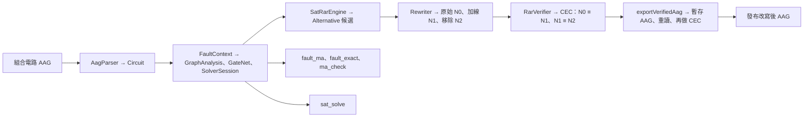

# SatRAR Circuit V2 程式導讀

`satrar-circuit-v2` 讀入組合邏輯 AAG，針對指定的 AND 輸入腳搜尋替代接線或子電路。它先加入替代邏輯，再把舊輸入腳固定為指定的 stuck-at 值並簡化電路。搜尋使用自製的 AIG gate 求解器。改寫是否保持所有輸出的行為，由獨立的 CNF miter 和 CaDiCaL 判定。

## 1．從輸入到改寫輸出



1. `app/main.cpp` 建立 `CommandShell` 並讀取 stdin。`read` 解析電路，建立一個 `FaultContext`，並清空前次候選。
2. `rar_search` 或 `rar_verify` 把「目標 AIG 變數、輸入腳、stuck-at 值」解析成 `PinFault`，交給 `SatRarEngine::run()`。引擎先算目標 fault 的必要指派，再對每個可接入的 postdominator 算 output sa0 fault 的必要指派，找出能區分兩種 fault 偵測條件的訊號。
3. `rar_search` 列出候選與搜尋計數。`rar_verify` 額外對每筆候選做兩階段 CEC。兩個命令都以本次結果取代 shell 的候選清單。
4. `rar_apply <id> <aag>` 用最近一次搜尋的候選編號，再做一次兩階段 CEC。通過後先寫到目的地同目錄的暫存檔，重讀該檔並與原電路做 CEC，才以 rename 發布。

## 2．模組、物件和函式

| 目錄與建置目標 | 職責 | 依賴 |
|---|---|---|
| `src/aig` → `satrar_v2_aig` | AAG、電路模型、模擬 | C++ 標準函式庫 |
| `src/solver` → `satrar_v2_solver` | Gate BCP、trail、推論理由、DPLL／CDCL | AIG |
| `src/analysis` 和部分 `src/rar` → `satrar_v2_rar` | 圖分析、fault 分析、候選搜尋、改寫 | solver |
| `src/sat` 和其餘 `src/rar` → `satrar_v2_verify` | CNF miter、CaDiCaL、CEC、AAG 發布 | AIG、RAR，預設建置同層 CaDiCaL CLI |
| `app`、`src/app` → `satrar_v2` | CLI、狀態管理及顯示 | RAR、verify |

V2 計畫保留 V1 的 AAG、電路改寫與 CEC 契約，把搜尋核心改成直接看 gate 的鄰接索引。這讓 fault 切換和推論理由可以沿同一條電路 trail 重用，最後仍可用另一套編碼與求解器檢查改寫。[CMakeLists.txt](../CMakeLists.txt) · [V2 計畫](../SatRAR_Circuit_Based_V2_Plan.md)

### 2.1 AIG 與 AAG

| 物件 | 作用與設計理由 | 函式入口 |
|---|---|---|
| `Literal` | 用 `raw = 2 × variable + inverted` 保存訊號與反相位元。raw 0／1 為常數 0／1。反相可以存在邊上，圖中只需 AND 節點。 | `fromVariable`、`raw`、`variable`、`inverted`、`isConstant`、`valueIfConstant`、`operator~`、`toString` |
| `NodeId`、`NodeKind`、`Node`、`AndInputs` | `NodeId` 是本電路內的節點索引。節點分成常數、PI、AND。AND 的輸入保存兩個帶極性的 literal，節點也保存 AAG 變數及可選 symbol。 | `isConstant`、`isPrimaryInput`、`isAnd`、`andInputs` |
| `WireRef`、`WireRefHash` | 用「目的節點、輸入腳 0 或 1」定位哪一條線。即使一個來源有多個 fanout，也能只改其中一腳。hash 支援在集合或映射中使用。 | `valid`、相等判斷、hash |
| `Circuit`、`CircuitStats` | 擁有節點、PI／PO 順序、AIG var 對 NodeId 的索引和 fanin／fanout 索引。圖分析、改寫、模擬共用同一模型。 | 查詢 `findNodeByAigVar`、`driverLiteral`、`faninWires`、`fanoutWires`、`stats` |
| `Circuit` 的建構、改寫與模擬 | 建構時保留 signed literal 與 I/O metadata。替換全部使用處會保留原來每條邊的反相。修改後重建鄰接索引。模擬可做小電路 oracle，以及重播 CEC 反例。 | `addConstantNode`、`addPrimaryInput`、`addAndGate`、`addPrimaryOutput`、`setInputSymbol`、`setOutputSymbol`、`setComment`、`replaceAndFanin`、`substituteAigVar`、`rebuildFaninFanout`、`validate`、`topologicalOrder`、`evaluate`、`clone` |
| `AagParser`、`AagWriter` | parser 讀 ASCII 組合 AAG 並驗證電路。內部 `RawLine` 和 `PendingAnd` 保留來源行號及待建立的 AND，供解析和診斷。writer 依拓撲順序輸出 AND，保留 PI／PO 順序、極性、symbols 和 comment。 | `parseFile`、`parseString`、`write`、`writeFile` |
| `ParseError` | header 宣告的診斷資料物件，包含訊息、檔案與行號。現行 parser 的錯誤路徑由 `throwParse` 組成帶檔案與行號的 `std::runtime_error`。 | `throwParse` |

同一個訊號可有三種編號。外部 AIG var 用於 AAG 與 CLI，`NodeId` 用於電路索引，solver 的 dense ID 用於緊密陣列。CEC 再獨立配置 DIMACS 變數。以 fixture 的 `g5` 為例，訊號 raw 23 是 AIG var 11 的反相，CLI 的 `-11` 表示同一帶極性的 literal，`23` 則表示正向 var 23。[AIG headers](../include/satrar/aig) · [Circuit.cpp](../src/aig/Circuit.cpp) · [Figure 1 fixture](../tests/fixtures/paper/fig1.aag)

### 2.2 Gate solver

| 物件 | 作用與設計理由 | 函式入口 |
|---|---|---|
| `GateNet`、`GateNet::Edge`、`GateNet::Gate` | 把 PI／AND 編成 dense ID，dense 0 保存常數基底，Edge 另外保存極性。每個訊號索引到以它為輸入或輸出的 gates。一次新指派只喚起相關 gate，包含向下游及向上游的推論。 | 建構式、`denseOfAig`、`literalOf`、`pack`、`incident`、`gate`、`primaryInputs` |
| `SolverSession` | 參照一個 `GateNet`，擁有指派、trail、決策層、傳播游標、衝突和學得條款。相同電路可以建立多個 session，分開保存目標與試探狀態。 | `seedRoot`、`resetAssignments`、`forgetLearned`、`enqueue`、`propagateGate`、`propagate` |
| `Mark`、`Entry`、`ConflictInfo`、`ReasonKind` | 私有記錄分別保存回復位置、每個指派的決策層與理由、衝突證據。`ReasonKind` 區分 Decision、Gate、Learned、Root。理由可用 clause 表達，供 explanation 和 CDCL resolution 共用。 | `value`、`level`、`isDecision`、`reasonKind`、`reasonClause` |
| `Checkpoint`、`ProbeResult`、`QueryState` | checkpoint 保存層數，probe 回傳推論狀態和新增 trail 的起點。`Open` 表示目前 BCP 沒有衝突，仍可能需要搜尋。 | `setAssumptions`、`newContextLevel`、`cancelToContextLevel`、`mark`、`rollback`、`probe`、`pushAssumption` |
| `Support` 與 learned clauses | `Support` 列出真的支撐某個推論或衝突的決策根。衝突可把整組根取反，形成可跨假設重用的 clause。 | `walk`、`decisionSupport`、`explain`、`explainConflict`、`learnNow`、`addClause`、`enforceClause` |
| `Budget`、`SolveResult`、`SolveState`、`SessionStats` | budget 管理 decision 和 propagation event 次數。`SolveResult` 帶 SAT／UNSAT／UNKNOWN、PI witness、原因及計數。`SessionStats` 統計 gate、clause、root 等工作量。 | `chargeEvent`、`chargeDecision`、`setCdcl`、`solve`、`analyze`、`backjumpLevel`、`stats` |

以 `z = x AND y` 為例，`x=0` 或 `y=0` 可推出 `z=0`，兩個輸入都為 1 才推出 `z=1`。反向傳播也成立，`z=1` 強迫兩個輸入為 1，`z=0,x=1` 推出 `y=0`。`z=0` 且兩輸入未知時保留分支。重複、互補輸入與常數也有對應處理。原始 gate 由 `propagateGate()` 評估，學得條款由變數索引觸發並掃描其 literals。

`setAssumptions()` 比較舊、新假設的共同前綴，回復到相同層，然後重加變動部分。`solve()` 先做假設傳播，再優先選未指派 PI、其次選 gate output。DPLL 會回溯並翻轉分支，CDCL 用理由做 1-UIP 分析與 backjump，回跳受假設層約束。CLI 的 exact 路徑打開 CDCL 並把 decision 上限設為 100,000。event budget 由傳入 `Budget` 的 propagation 路徑扣除，根層及部分假設與回復傳播使用無 budget 的路徑，因此這個值適合當搜尋計數，無法當整個查詢的硬時間上限。[GateNet.cpp](../src/solver/GateNet.cpp) · [SolverSession.hpp](../include/satrar/solver/SolverSession.hpp) · [SolverSession.cpp](../src/solver/SolverSession.cpp)

### 2.3 圖分析、故障與必要指派

| 物件 | 作用與設計理由 | 函式入口 |
|---|---|---|
| `GraphAnalysis` | 參照電路。用 fanin／fanout 找可受影響節點與存活邏輯，將所有 PO 接到概念上的共同 sink，反拓撲計算並快取 postdominator chain。接入點必須位於故障可觀測路徑的共同下游。 | `faninCone`、`fanoutCone`、`outputPostdominators`、`dominatorsForWire`、`wouldCreateCycle`、`wouldBypassWireCreateCycle` |
| `StuckAt`、`PinFault`、`DominatorOutputFault` | stuck-at 表示固定為 0／1。`PinFault` 只影響指定接收腳。output fault 固定該 gate 的輸出，因此會影響該訊號的所有下游用法。 | `setPinFault`、`setDominatorOutputFault` |
| `FaultContext` | 擁有 `Circuit → GraphAnalysis／GateNet → SolverSession`，並保存當前 fault、偵測前提、狀態與 profile。fast MA 共用原電路 session，避免每次重建。 | `excitation`、`computeMandatoryAssignments`、`snapshot`、`resetSolver`、`clearFault`、`requirements` |
| `MandatoryAssignment`、`MandatoryAssignments` | 將目前 trail 快照成可按 signed literal 查值的集合，保留層數和是否由傳播得到，讓 engine 比較 target 與 dominator 的 MA。帶 trial 時，快照也包含條件指派。 | `add`、`clear`、`items`、`valueOf` |
| `FaultContext::Miter` | 暫時 AIG，含 good 訊號映射、偵測 literal 和是否有受影響的 PO。good／faulty 共用 PI，受影響 cone 外共用邏輯。受影響 PO 各做 XOR，再 OR 成 `D_f`。 | `buildMiter`、`project` |
| `FaultStatus`、`FaultProfile`、`ExactAnswer` | fast MA 回報狀態及 projection／傳播統計。exact 結果帶 witness、求解原因、fault 是否冗餘及查詢 literal 是否必要。 | `status`、`profile`、`solveDetection`、`checkMandatory` |

**Fast MA。** 要測 stuck-at fault，good 電路的目標訊號值必須與 stuck 值相反。要讓差異穿過單側受影響的 AND，另一側必須為 1。`computeMandatoryAssignments()` 從可觀測端沿 postdominator chain 收集這些條件，加上 excitation 與額外 trial，交給原電路 session 傳播。遇到匯合情形，先令 AIG miter 的 `D_f=1`，把能推出的 good-view 值投影回原電路。若沒有推得衝突，這條分支仍標為 `NeedsExactTest`。傳播得到的 MA 集合可能不完整，`Consistent` 表示條件目前相容。

**Exact。** `solveDetection()` 建立 miter，將 `D_f=1` 和額外 good-view 條件給新 session 求解。SAT 的 PI 可讓 good 與 faulty 在 PO 上不同。無額外條件時，UNSAT 表示 fault 冗餘。`checkMandatory(l)` 先確認 `D_f` 可滿足，再求 `D_f ∧ ¬l`。後者 UNSAT 才將 `l` 判為必要，前者 UNSAT 則回報 `redundant_fault`，避免把不可偵測故障中的所有指派視為 MA。[GraphAnalysis.cpp](../src/analysis/GraphAnalysis.cpp) · [FaultContext.cpp](../src/analysis/FaultContext.cpp) · [MandatoryAssignments.cpp](../src/analysis/MandatoryAssignments.cpp)

### 2.4 搜尋物件、候選及改寫

| 物件 | 作用與設計理由 | 函式入口 |
|---|---|---|
| `SatRarEngine` | 借用 `FaultContext`。每輪初始化搜尋狀態，依 target MA、dom MA 和理由探索候選。中途證明冗餘或試探達限時，記錄發生位置。 | `setOptions`、`setPinTarget`、`run`、`statistics` |
| `SatRarMode`、`SatRarOptions` | 支援六個演算法模式，CLI 另有兩個 Gate 開關組合。預設 trial 上限 20,000、Gate／Sub trial 深度 2，可排除直接接收 gate，亦可提供 trace callback。 | `parseMode`、`consumeTrial`、`recursiveLearn` |
| `SatRarStatistics`、`RedundancyEvent` | 保存 trial、學得條款、filter、sub probes、gate／clause visits、limit 與時間。冗餘事件標出 target 或 dominator 和節點。 | `statistics` |
| `Attachment`、`WireAlternative`、`GateAlternative`、`Alternative` | attachment 記錄 target、接入 dominator、證據標籤。wire 保存實際接入的 signed literal。gate 保存 separator 的 AND 項和選擇性 OR 項。variant 讓 verifier 和 rewriter 共用同一套候選介面。 | `canonicalKey`、`emit` |
| `Rewriter` | 先 clone、確認接入點且檢查組合迴圈，加入 `dom ∧ condition`，把舊 dom 的使用處改接 wrapper。解除 target 時只把該腳綁到 stuck 常數，再做兩次常數折疊與 PO 可達性清理。 | `addAlternative`、`removeTarget`、`simplify`、`applyWireAlternative`、`removeTargetAfterWire` |

搜尋共同流程如下。

1. 對指定 pin fault 求 target MA，再對各 postdominator 的 output sa0 求 dom MA。淘汰常數與位於 target fanout cone 內的來源，避免讓新增條件依賴本來會被 fault 改變的訊號。
2. 若某個 target MA 在 dom context 下取反，直接產生 opposite-MA wire。對 dom 尚未知的 target MA，SatRAR 模式會暫時加到 trail。推得衝突或推出另一個 target MA 的反值，就回溯 reason 找真正參與的 trial roots，組成 separator。
3. `install` 安裝由完整衝突決策根取反得到的 clause，讓後續試探能立即使用。產生候選時使用的 trial roots 則須從完整理由中篩出。implication filter 略過已由另一個首層 trial 推出的部分 MA，減少重複試探。回復時保留原本仍有效的前提和學習。
4. `emit` 按 dominator 和兩組 sorted raw operands 去重。separator `S` 需在 target 偵測向量上為 1，在 dom sa0 偵測向量上為 0。wire 情形接入 `¬S` 的單一 literal，gate／sub 情形用 `¬(AND(A) ∧ OR(B))`，其中空的 `B` 省略 OR。如此，新增輸入可阻斷 target 差異，同時在 dom 必須維持 1 的偵測向量上保持為 1。兩項性質分別用改寫後的 CEC 驗收。

| CLI 模式 | 推論方式 |
|---|---|
| `l0` | 直接 BCP 加 opposite MA。 |
| `l1`、`l2` | `recursiveLearn` 對未定的 `AND=0` 分別試兩個輸入為 0，取可行分支共同指派。遞迴深度分別為 1、2。 |
| `wire` | 加入單一 MA 試探。單一 trial root 造成衝突時可導出 wire，例如 Theorem-1。 |
| `gate` | 允許多決策根的衝突與 reverse implication。依理由標為 Theorem-2、Corollary-2.1、Corollary-2.2 等，亦保留可找到的 wire。 |
| `gate_nolearn`、`gate_nofilter` | 分別停用衝突 clause 安裝或 implication filter，其餘採 Gate 模式。 |
| `sub` | 在 Gate 搜尋中額外使用 target oracle。對候選 OR 項同時取反，若 target 前提下傳播衝突，嘗試移除多餘項，再組成 Theorem-3 的 AND–OR 候選。 |

`canonicalKey` 使用目標變數、pin、stuck 值、dom 變數、候選類別與 raw literals。例 `13,0,1,15,w,23` 表示目標 `g7` 的 pin 0 sa1，替代訊號 raw 23（`g5`）接到 var 15（`g9`）。候選 ID 是當次 CLI 列表的位置，key 可用於不同執行之間對照。[SatRarEngine.cpp](../src/rar/SatRarEngine.cpp) · [Alternative.hpp](../include/satrar/rar/Alternative.hpp) · [Rewriter.cpp](../src/rar/Rewriter.cpp)

### 2.5 CNF 驗證和輸出物件

| 物件 | 作用與設計理由 | 函式入口 |
|---|---|---|
| `DimacsLiteral`、`CnfFormula`、`CnfConstVars` | DIMACS 用帶符號的整數表示變數極性。`CnfFormula` 管理變數、映射和 clauses。常數 helper 配置固定假與固定真變數。 | `dimacsFromVar`、`dimacsVariable`、`newVariable`、`ensureAigVar`、`addClause`、`writeDimacs`、`bindAigConstants`、`ensureAigConstants` |
| `CnfEncoder` | 單一 AIG 的 Tseitin 編碼工具。每個 AND 轉為三條子句，並提供 AIG 到 DIMACS 的 literal 查詢。 | `encodeCircuit`、`positiveLit`、`dimacsLitForAig` |
| `MiterBuilder`、`EncodedCircuit`、`MiterSide` | CEC 的雙電路編碼入口。兩側按 PI 位置共用 SAT 變數，內部 gates 各配獨立變數，按 PO 位置對比 XOR，並要求至少一個輸出相異。 | `primaryInputEncodingKey`、`encode`、`buildXorMiter`、`buildNotEquivalentFormula` |
| `SatBackend`、`CadicalBackend`、`SatVerdict`、`SatSolveResult` | backend 介面將外部求解與 CEC 分開。CaDiCaL 以子行程讀 DIMACS，等待 exit code、解析 model，並回報超時或執行錯誤。 | `solveDimacsFile`、`available`、`describe`、`setExecutable`、`defaultVerificationBackend` |
| `TempDirectory` | RAII 管理求解期間的暫存 DIMACS 和 solver log，離開作用域時清理。 | 建構式、解構式、`path` |
| `EquivalenceChecker`、`EquivalenceResult`、`EquivalenceVerdict` | 建立 miter 並求可區分輸入。UNSAT 代表等價。SAT 需讀回所有 PI 並模擬兩個電路，確認哪個 PO 的結果相異。 | `check`、`equivalenceVerdictName` |
| `RarVerifier`、`RarVerificationResult`、`RarStage`、`RarAcceptance` | 先驗 `N0 ≡ N1`，通過才驗 `N1 ≡ N2`。只有兩階段均等價才回傳改寫電路。可重播的反例判拒絕，逾時或 backend 錯誤回報 `indeterminate`。 | `verify`、`rarAcceptanceName`、`rarStageName` |
| `ExportOptions`、`ExportResult` | 提供 CEC timeout、可選的發佈前 hook，以及寫檔和重讀驗證結果。檔案重讀後再做一次 `N0 ≡ reloaded`，讓驗證覆蓋序列化結果。 | `exportVerifiedAag`、`temporaryFor` |

兩個 miter 的用途可由它們的輸入區分。fault miter 比較同一電路的 good／stuck-at 行為，用 AIG 求偵測向量。CEC miter 比較兩個完整版本的電路，用 CNF 求 PO 差異。CEC 的 I/O 契約是**同位置對同位置**，和 AIG var 編號或 symbol 無關。CMake 預設由 `../satrar-cpp/third_party/cadical` 建置驗證用 CLI，`SATRAR_CADICAL_EXE` 可指定其他執行檔。[MiterBuilder.cpp](../src/sat/MiterBuilder.cpp) · [EquivalenceChecker.cpp](../src/rar/EquivalenceChecker.cpp) · [RarVerifier.cpp](../src/rar/RarVerifier.cpp) · [ExportAag.cpp](../src/rar/ExportAag.cpp)

### 2.6 CLI 的函式入口

| 命令 | 函式與狀態 |
|---|---|
| `help`、`quit`、`exit` | `run` 逐行呼叫 `executeLine`。`printHelp` 列主命令，`quit`／`exit` 停止讀入。 |
| `read` | `commandRead` 解析 AAG、換掉 context、清空候選、印電路規模。 |
| `fault_ma pin`／`dom` | `commandFaultMa` 用目前 context 傳播，列狀態與 trail 的 raw、level、decision flag。可加 `trial` 與 signed vars。 |
| `rar_search`／`rar_verify` | `commandRar` 解析 target 和模式，保存候選，印 canonical key。verify 額外印各候選的 CEC verdict。 |
| `rar_apply` | `commandApply` 依候選 ID 重做驗證並發布檔案。 |
| `sat_solve` | `commandSat` 建立新 session，對原電路的 signed 假設做 exact SAT，列 PI witness。要限定某個 PO 值，需把該 PO 的 signed AIG var 加入假設。 |
| `fault_exact pin`／`dom` | `commandExact` 對 fault miter 求可偵測 PI 或冗餘。 |
| `ma_check pin` | `commandMaCheck` 用 exact 查某 signed literal 對指定 pin fault 是否必要。 |

`parsePin` 把 AIG 變數查成 NodeId，再組成 `PinFault`。`signedVariable` 把 CLI 的正／負 AIG 變數轉成 literal。CLI 逐行捕捉例外並把 `error:` 寫到 stderr，`main` 最後回傳 0，因此批次執行應以命令輸出判斷個別結果。[CommandShell.cpp](../src/app/CommandShell.cpp) · [main.cpp](../app/main.cpp)

## 3．測試與實測結果

2026-11-25 在 Windows 用現有 MSVC x64 CMake 目錄重新建置並執行 CTest。Release **6/6 通過（1.38 秒）**，Debug **6/6 通過（4.23 秒）**，兩組都執行了 CaDiCaL CEC test。

| CTest | 實際覆蓋 |
|---|---|
| [test_gate_bcp](../tests/test_gate_bcp.cpp) | 用 truth table 比對每組 `x,y,z` 的 27 個三值部分指派，涵蓋反相、同訊號、互補、常數，並檢查 root reason、learned clause、probe 與 rollback。 |
| [test_fault_ma](../tests/test_fault_ma.cpp) | Figure 1 六 PI 窮舉。target sa1、g7 sa0、g9 sa0 的偵測向量數分別為 **3、3、7**。檢查 target MA 在所有偵測向量上成立，包含 Figure 6 的 `f=1 → g4=0` 前綴與 `d=0` 試探回復。 |
| [test_rar_anchors](../tests/test_rar_anchors.cpp) | `g5→g9` 在 L0／L1 缺席，L2／wire 出現。檢查 g7 的 separator raw `{9,22}`、Corollary-2.1／2.2、Theorem-3 fixtures，並窮舉驗證候選分離條件與兩階段等價，涵蓋 Gate 的學習／filter 四種組合和 trial cap。 |
| [test_exact](../tests/test_exact.cpp) | DPLL 與 CDCL 的 SAT／UNSAT 結果、PI witness 重播和零 decision cap 回傳 UNKNOWN。另驗證 Figure 1 的 true／false MA，以及 g9 sa0 加 g5=0 後的 UNSAT。 |
| [test_aag_roundtrip](../tests/test_aag_roundtrip.cpp) | Figure 1 寫出後重讀，核對 PI／PO／AND 數量、兩個 PO signed literals，並模擬一組 PI。 |
| [test_cec](../tests/test_cec.cpp) | Figure 1 wire 模式 **4/4** 通過 CaDiCaL 的兩階段 CEC，再將其中一筆寫成 AAG、重讀並驗證發布。 |

### Figure 1 的八種 CLI 模式

固定 target 為 `g6→g7` 的 receiving pin 0 sa1。每個模式用新 Release 行程執行 `read` 和 `rar_verify`。下表的候選、trial、learned、gate visits 與現有 `results/v5/fig1_modes.tsv` 相同，CEC accepted 是本次重跑結果。

| 模式 | 候選 | Trials | Learned | Gate visits | CEC accepted |
|---|---:|---:|---:|---:|---:|
| l0 | 1 | 0 | 0 | 65 | 1 |
| l1 | 3 | 12 | 0 | 148 | 3 |
| l2 | 4 | 28 | 0 | 221 | 4 |
| wire | 4 | 9 | 3 | 172 | 4 |
| gate | 16 | 13 | 4 | 214 | 16 |
| gate_nolearn | 20 | 16 | 0 | 250 | 20 |
| gate_nofilter | 24 | 51 | 4 | 529 | 24 |
| sub | 20 | 27 | 4 | 214 | 20 |

合計 **92/92 筆模式輸出**通過 CEC，所有模式均為 `limited=0`。同一個 canonical key 可出現在多個模式。這個 fixture 中，L2 與 wire 的四個 keys 相同，wire 用 9 次 trial、L2 用 28 次。關閉 Gate 的 filter 時，trial 由 13 增至 51，候選由 16 增至 24，量到的差異涵蓋探索範圍和工作量。上表保留當時新行程量測的 gate visits。現行 CLI 的 `gate_visits`／`clause_visits` 計算各次搜尋的 session 計數差值，因此可以在同一 shell 比較，與歷史 TSV 的計數起點有差異。[歷史結果 TSV](../results/v5/fig1_modes.tsv) · [模式腳本](../scripts/compare_v1_v2.ps1)

### Figure 1 的命令與輸出

| 命令 | 實測結果 |
|---|---|
| `read tests/fixtures/paper/fig1.aag` | 6 PI、2 PO、9 AND、18 wires。 |
| `fault_ma pin 13 0 sa1` | `consistent`，trail 13 筆。 |
| `fault_ma dom 13 sa0 trial -4` | `consistent`，trail 15 筆，含 `d=0` 的試探與衍生指派。 |
| `sat_solve 15` | SAT，PI 向量 `0 1 1 1 0 1`。 |
| `fault_exact pin 13 0 sa1` | SAT，偵測 PI 向量 `1 1 0 0 0 1`。 |
| `ma_check pin 13 0 sa1 12` | `mandatory`。正向 var 12 是 fixture 裡的 `g6=0`。 |
| `rar_apply 0 <temp.aag>` 並 `read <temp.aag>` | `verified_equivalent`、`published`，重讀成功。採用前一步 `sub` 的候選 0，重讀仍為 9 AND，這個候選的結果證明功能等價。 |

### 重跑與結果範圍

從 `satrar-circuit-v2` 目錄執行。若 CMake 未加入 PATH，可從 `build-msvc/CMakeCache.txt` 的 `CMAKE_COMMAND`、`CMAKE_CTEST_COMMAND` 取得實際路徑。

```powershell
cmake --build build-msvc --config Release
ctest --test-dir build-msvc -C Release --output-on-failure
cmake --build build-msvc --config Debug
ctest --test-dir build-msvc -C Debug --output-on-failure

foreach ($mode in 'l0','l1','l2','wire','gate','gate_nolearn','gate_nofilter','sub') {
    @('read tests/fixtures/paper/fig1.aag', "rar_verify 13 0 sa1 $mode") |
        & ./build-msvc/Release/satrar_v2.exe
}
```

此處的正確性證據涵蓋小型 fixtures 和 Figure 1 的指定 target，搜尋候選受模式、深度、filter 和 `maxTrials` 影響。大型 C432–b19 的 Table I／II 目前有 manifest，這次驗證範圍止於上述測試。現有 `compare_v1_v2.ps1` 實際執行 V2 的 `rar_search` 並寫各模式的 keys，`-V1Exe` 只印出路徑，故 V1/V2 候選集合和效能須另做雙邊量測。[V2 狀態](V2_STATUS.md) · [Benchmark manifest](../benchmarks/manifests/aspdac2009.json) · [模式腳本](../scripts/compare_v1_v2.ps1)
