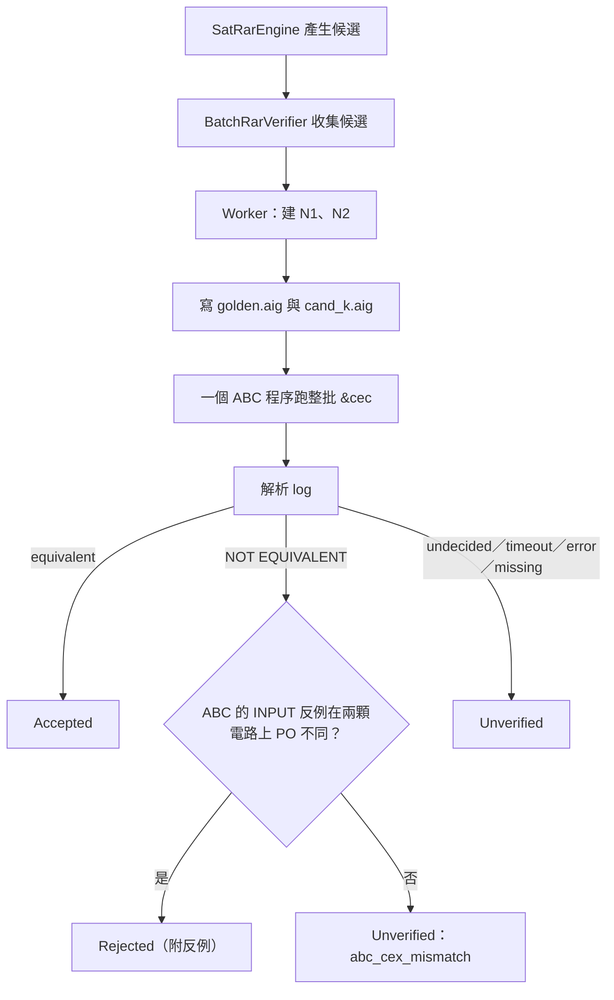

# SatRAR ABC CEC 計畫：以 ABC 作為唯一驗證器

2026-11-26 · EdaLab · C++17／CMake／Windows x64 · 修改專案 `satrar-cpp/`

## 0. 交給 Claude／Cursor 的任務

在 `C:/Users/User/Documents/file/NTU/EdaLab/satrar-cpp` 把 RAR 候選的等價檢查（CEC）全部改由 [berkeley-abc](https://github.com/berkeley-abc/abc) 的 `&cec` 完成，**移除 CaDiCaL 在 CEC 中的所有角色**。依 Phase 0–6 實作與驗收，Phase 7 選做。

- **ABC 是唯一的證明引擎。** 不保留 CaDiCaL 作 reference、fallback 或稽核，也不自己寫 CNF miter、strash 或任何等價證明演算法。專案只負責：把電路寫成 ABC 能讀的檔案、呼叫 ABC、讀回 ABC 的結論。
- **不改 SatRAR 搜尋。** `SatRarEngine`、候選產生、`Rewriter` 的語意都不動。
- **結論規則：**
  - `Accepted`：ABC 對該 job 恰好回報一次 `Networks are equivalent`。
  - `Rejected`：ABC 回報 `Networks are NOT EQUIVALENT`，且它印出的 `INPUT:` 反例代入兩顆電路後，`Circuit::evaluate` 的 PO 真的不同。這一步只是確認 ABC 的反例與我們的檔案對得上，不是另一個驗證器；`Circuit::evaluate` 是現有的模擬函式。
  - `Unverified`：其他所有情況（逾時、undecided、讀檔錯誤、log 無法判讀、反例重播不出差異）。不會退回其他 solver。
- 每個 Phase 交付時須能 configure、build、CTest（Release 與 Debug）。附上所用命令、通過條件、失敗輸入或設定，以及下一步的程式入口。
- 草碼以現有 API 為準（`aig::Circuit`、`aig::Literal`、`rar::Alternative`、`sat::TempDirectory`）。ABC 的旗標與輸出字串以 Phase 0 實測為準；之後若發現不同，以實測為準並更新本文件。

### 工作基線

| 資料 | 內容 |
|---|---|
| `results/aspdac_wire_cec/runs/*.json` | 舊 CaDiCaL CEC 留下的 checkpoint：C432 1,112 候選 110 s、C499 698 候選 101 s、C3540 4,804 候選 3,958 s、C6288 0 候選。全部 `verified_alts == #alt`，`rejected = 0`。只當作**已記錄的對照數字**，不再執行 CaDiCaL。 |
| `results/spec_fig1/` | Figure 1 八模式 623 筆候選，舊流程全部通過兩段 CEC。 |
| `results/aspdac_wire_20261126/summary.tsv`、`results/aspdac_wire_b17/summary.tsv` | 12 個電路的 discovery 結果。C7552、b01、b13、b14、b15、b17 的 CEC 尚未完成。 |
| `src/rar/EquivalenceChecker.cpp` | 現在：建整顆電路的 miter CNF、寫 `miter.cnf`、呼叫 CaDiCaL、重播 SAT model。改完後只剩 ABC 呼叫的包裝。 |
| `src/rar/RarVerifier.cpp` | 兩段 CEC：N0≡N1（加入 alternative）、N1≡N2（移除 target）。 |
| `src/rar/ExportAag.cpp` | `rar_apply` 寫檔前的 round-trip CEC。 |
| `src/app/CommandShell.cpp` | CEC 呼叫點：`verify_equiv`（約 614 行）、`rar_verify`（約 733 行）、`rar_apply`（約 750 行）、`rar_batch`（約 771–865 行）。`sat_solve`（約 605 行）只解 DIMACS，不屬於 CEC。 |
| `scripts/rar_batch.py` | `SCHEMA_VERSION = 4`；`--solver` 與 fingerprint 目前指向 `satrar_cadical`。 |
| `tools/abc/` | Phase 0 已放好 `bin/yosys-abc.exe` 與 DLL（不進 git）、`ABC_VERSION.txt`、`README.md`。 |

### 目標與成功指標

| 指標 | 目標 |
|---|---|
| 正確性 | C432、C499、C3540、C6288 的 `#alt`、`verified_alts`、`rejected` 與舊 checkpoint 相同；Figure 1 八模式 623 筆全部 Accepted；注入錯誤的候選 100% `Rejected` 且反例重播成功；隨機小電路上 ABC 結論與窮舉模擬 100% 一致。 |
| 速度（單 worker） | C3540 CEC 從 3,958 s 降到 ≤ 400 s。 |
| 速度（多 worker） | `--cec-jobs 8` 時 C3540 ≤ 100 s。 |
| 完整性 | C7552、b01、b13、b14、b15、b17 的 CEC 全部跑完，`verify_status = complete`。 |
| 清理 | `satrar-cpp` 的建置、CLI、腳本與測試不再需要 CaDiCaL。 |

速度目標是 Phase 2 微基準的決策門檻，不是保證。

## 1. 為什麼改用 ABC

現在每個候選要：`addAlternative` 與 `removeTarget`；兩次把整顆電路編成 CNF miter；兩次建暫存目錄、寫檔、開一個 CaDiCaL 程序。CaDiCaL 看不到電路結構，只能在兩份幾乎相同的電路上硬證每一對 PO 相等，而且候選依序處理。

ABC 的 `&cec` 先做 structural hashing，再用模擬加 SAT sweeping 逐點合併。RAR 每次只改一條 wire 加一個 alternative，大部分電路在 hashing 就合併，剩下的局部問題很小。Phase 0 已量到：一個 ABC 程序連跑 100 個 C3540 job，每個 2.12 ms。

## 2. 設計總覽



### 不變式（寫進程式註解與測試）

1. **只有 ABC 能產生 Accepted。** 每個 job 的 log 區塊必須恰好一行結論；有 error 行、零行或多行結論都是 `Unverified`。
2. **Rejected 必須附反例。** 反例來自 ABC 印出的 `INPUT:` 行；重播不出差異時記為 `Unverified` 並增加 `cec_cex_mismatches`。這代表檔案轉換或對應有錯，必須當 bug 處理。
3. **PI／PO 依位置對應。** `&cec` 一律依位置比對。兩個檔案用相同的 PI 數量與順序，即使某些 PI 不在 cone 裡也要寫出；名稱固定寫 `i<k>`／`o<k>`，方便讀反例。
4. **不讀 exit code 判斷結論。** Phase 0 實測：讀檔錯誤時 ABC 的 exit code 仍是 0，結論只能從 log 判讀。
5. **兩種驗證語意：**
   - `two`（預設，對照論文）：N0≡N1 與 N1≡N2 兩個 ABC job，語意等同現有程式。
   - `e2e`（速度優先）：只檢查 N0≡N2。這是對外保證真正需要的條件；兩段檢查是它的充分條件。理論上可能有 N0≢N1 但 N0≡N2 的候選，此時 `e2e` 接受而 `two` 不接受；論文對照一律用 `two`，`e2e` 另外統計差異數。

## 3. 目錄與模組

| 檔案 | 責任 | Phase |
|---|---|---|
| `include/satrar/aig/AigWriter.hpp`、`src/aig/AigWriter.cpp` | binary AIGER（`.aig`）輸出：重新編號、cone-only、canonical 名稱 | 1 |
| `include/satrar/sat/ProcessRunner.hpp`、`src/sat/ProcessRunner.cpp` | 通用程序執行：工作目錄、參數、log、timeout、kill。程式碼從 `CadicalBackend::runSolver` 搬出 | 1 |
| `include/satrar/rar/EquivalenceResult.hpp` | 從 `EquivalenceChecker.hpp` 搬出 `EquivalenceVerdict`、`EquivalenceResult`，不依賴任何 solver | 2 |
| `include/satrar/cec/CecChecker.hpp` | CEC 介面與 `CecJob`。正式實作只有 ABC；介面存在是為了讓測試能注入假的結果 | 2 |
| `include/satrar/cec/AbcLog.hpp`、`src/cec/AbcLog.cpp` | ABC script 產生、log 解析、`INPUT:` 反例解析（純函式，可單獨測試） | 2 |
| `include/satrar/cec/AbcCec.hpp`、`src/cec/AbcCec.cpp` | ABC 批次執行、逾時重試、反例重播 | 2 |
| `src/rar/EquivalenceChecker.cpp` | 改成 `CecChecker` 的單一 job 包裝，保留 `check(golden, candidate, timeout)` 給既有呼叫點 | 3 |
| `src/rar/RarVerifier.cpp`、`src/rar/ExportAag.cpp` | 改吃 `const cec::CecChecker&` | 3 |
| `include/satrar/rar/BatchRarVerifier.hpp`、`src/rar/BatchRarVerifier.cpp` | 候選 → job、`two`／`e2e`、ticket 排序、worker pool | 4 |
| `include/satrar/app/CecSettings.hpp` | shell 的 `set cec_*` 設定 | 5 |
| `src/app/CommandShell.cpp` | 所有 CEC 指令改用 ABC；新增 `set`／`show cec`／`rar_dump` | 1、3、5 |
| `scripts/rar_batch.py` | `--abc` 取代 `--solver`、schema 5、新欄位與 fingerprint | 5 |
| `scripts/aag_to_aig.py`、`scripts/abc_probe.ps1` | Phase 0 已完成：轉檔對照實作、ABC 探測 | 0 |
| `tools/abc/` | ABC 執行檔與版本紀錄 | 0 |
| `tests/test_aig_writer.cpp`、`test_process_runner.cpp`、`test_abc_log.cpp`、`test_abc_cec.cpp`、`test_abc_oracle.cpp`、`test_batch_verifier.cpp` | 新測試 | 1–4 |
| `tests/test_verification_stages.cpp`、`tests/test_equivalence.cpp` | 改用假的 `CecChecker` 與 ABC | 3 |
| `tests/fixtures/abc/*.log` | Phase 0 擷取的真實 ABC 輸出 | 0、2 |

依賴方向：`cec → aig, sat/ProcessRunner, rar/EquivalenceResult`；`rar → cec`；`app → rar, cec`。`cec` 不依賴 `analysis` 或 `SatRarEngine`。`MiterBuilder`、`CnfEncoder` 和 MiniSat 仍被 `FaultContext` 的故障分析使用，不在移除範圍內。

ABC 是**執行期**依賴，不在建置時連結（Phase 7 才可選擇連結）。尋找順序：環境變數 `SATRAR_ABC_EXE` → CMake 快取變數 `SATRAR_ABC_EXECUTABLE` → 與 `satrar.exe` 同層的 `yosys-abc.exe`／`abc.exe` → repo 的 `tools/abc/bin/yosys-abc.exe`。都找不到時 `available() == false`，所有 CEC 回報 `Unverified`，ABC 相關測試回傳 77（跳過）。

```cmake
# satrar_core 新增
    src/aig/AigWriter.cpp
    src/sat/ProcessRunner.cpp
    src/cec/AbcLog.cpp
    src/cec/AbcCec.cpp
    src/rar/BatchRarVerifier.cpp

set(SATRAR_ABC_EXECUTABLE "${CMAKE_SOURCE_DIR}/tools/abc/bin/yosys-abc.exe"
    CACHE FILEPATH "ABC executable used for every CEC")
target_compile_definitions(satrar_core PRIVATE SATRAR_CONFIGURED_ABC="${SATRAR_ABC_EXECUTABLE}")

satrar_add_test(test_aig_writer tests/test_aig_writer.cpp)
satrar_add_test(test_process_runner tests/test_process_runner.cpp)
satrar_add_test(test_abc_log tests/test_abc_log.cpp)
satrar_add_test(test_abc_cec tests/test_abc_cec.cpp)
satrar_add_test(test_abc_oracle tests/test_abc_oracle.cpp)
satrar_add_test(test_batch_verifier tests/test_batch_verifier.cpp)
set_tests_properties(test_abc_cec test_abc_oracle test_batch_verifier test_equivalence
                     PROPERTIES SKIP_RETURN_CODE 77)
```

## 4. Phase 0｜取得 ABC 與探測（已完成，2026-11-26）

ABC 是 OSS CAD Suite `2026-11-25` 的 `yosys-abc.exe`，版本 `UC Berkeley, ABC 1.01 (compiled Nov 25 2026 09:48:23)`。執行檔旁邊要有 `libgcc_s_seh-1.dll`、`libreadline8.dll`、`libstdc++-6.dll`、`libwinpthread-1.dll`、`libtermcap-0.dll`。sha256 與下載網址在 `tools/abc/ABC_VERSION.txt`，取得方式在 `tools/abc/README.md`，探測紀錄在 `results/abc_probe/`。

| 項目 | 實測 | 對實作的影響 |
|---|---|---|
| 讀 `.aag` | `read_aiger` 失敗：`Wrong input file format`。本專案的 AAG 在 header 後多了每個 PI 的 literal 行。 | 一律寫 binary `.aig`（Phase 1 `AigWriter`）。 |
| `echo` | 可用，輸出帶一個尾端空白：`SATRAR_BEGIN 7 `。 | 批次 log 用 echo marker 分段，比對前先 trim。 |
| `&cec a.aig b.aig` | 讀兩個檔，依位置比對；`-T` 預設 0（不限時）、`-C` 預設每節點 1000 conflict。 | 正式命令；每個 job 明確帶 `-T`。 |
| `cec` | 預設依**名稱**比對，`-n` 才依順序；`-T` 預設 20 s。 | 不用作正式命令。 |
| Figure 1 vs 改寫後電路 | `cec`：`Networks are equivalent after structural hashing.` | 等價句前綴為 `Networks are equivalent`。 |
| Figure 1 vs 反相 o0 | `&cec`：`Networks are NOT EQUIVALENT. Output 0 trivially differs (different phase).`，下一行 `INPUT: i0 = 1'h0, i1 = 1'h0, ... i5 = 1'h0.  OUTPUT: z = 2'h0 (fig1), z = 2'h1 (fig1-bad).` | 反例直接從 `INPUT:` 行解析，名稱就是我們寫入的 `i<k>`。 |
| 讀不到檔案 | `Error: Cannot open input file "missing.aig".`，exit code 0。 | 結論只看 log。 |
| C3540 vs 自己，每 job 一個程序 | 平均 42.8 ms。 | 必須批次。 |
| C3540 vs 自己，一個程序 100 job | 2.12 ms／job，100／100 等價。 | 通過 ≤ 40 ms 門檻。 |
| C3540 vs ABC 改寫版 | `&cec` 0.03 s（牆鐘 76 ms）；`&cec -T 1` 同樣等價；`cec -n` 0.10 s。 | `&cec` 比 `cec -n` 快。 |

`write_cex` 在 `&cec` 之後回報 `Empty network.`，反例不能靠它取得，只能解析 `INPUT:` 行。

Phase 1 開始前補兩個探測（加進 `abc_probe.ps1`）：

1. **Undecided 字串：** 用 C6288 對 ABC 改寫版跑 `&cec -C 1 -T 1`，擷取無法判定時的實際輸出，存成 `tests/fixtures/abc/undecided.log`。若無法觸發，記錄「未觀察到」，parser 把任何沒有 equivalent／NOT EQUIVALENT 的區塊都當 `Unverified`。
2. **大電路反例：** 對 b17 反相一個 PO 跑 `&cec`，確認 `INPUT:` 行列出全部 PI（b17 有上千個 PI），存成 fixture。

## 5. Phase 1｜binary AIGER 輸出、程序執行器、`rar_dump`（約 1 天）

### 5.1 `AigWriter`

```cpp
// include/satrar/aig/AigWriter.hpp
#pragma once

#include "satrar/aig/Circuit.hpp"

#include <cstdint>
#include <filesystem>
#include <ostream>

namespace satrar::aig {

struct AigWriteOptions {
    /// Keep only AND gates in the transitive fanin of the primary outputs.
    bool coneOnly = true;
    /// Write i<k>/o<k> names; ABC prints counterexamples with these names.
    bool canonicalSymbols = true;
};

struct AigWriteStats {
    std::uint32_t inputs = 0;
    std::uint32_t outputs = 0;
    std::uint32_t ands = 0;
};

/// Combinational binary AIGER (.aig). Every primary input is written, even outside the cone.
class AigWriter {
public:
    static AigWriteStats write(const Circuit& circuit, std::ostream& out,
                               const AigWriteOptions& options = {});
    static AigWriteStats writeFile(const Circuit& circuit, const std::filesystem::path& path,
                                   const AigWriteOptions& options = {});
};

}  // namespace satrar::aig
```

實作步驟（`src/aig/AigWriter.cpp`），規則與 `scripts/aag_to_aig.py` 相同：

1. **PI 編號：** `primaryInputIds()[k]` 的 `aagVar` 對應新變數 `k + 1`。
2. **選 AND：** 依 `topologicalOrder()` 走訪；`coneOnly` 時先從 PO driver 反向標記 cone，只保留被標記的 AND。依走訪順序給新變數 `I + 1`、`I + 2`…，保證 `lhs > rhs0`。
3. **字面轉換：**

   ```cpp
   std::uint32_t mapLiteral(Literal lit) const {
       if (lit.isConstant()) return lit.raw();               // 0 = false, 1 = true
       return 2 * newVar_.at(lit.variable()) + (lit.inverted() ? 1u : 0u);
   }
   ```

4. **Header：** `aig M I 0 O A\n`，`M = I + A`。
5. **Outputs：** 每個 PO 一行十進位字面。
6. **AND 區段（binary）：** 第 i 個 AND 的 `lhs = 2 * (I + i + 1)`，`r0 = max(a, b)`、`r1 = min(a, b)`，依序寫 `lhs - r0` 與 `r0 - r1` 的 7-bit 小端變長編碼：

   ```cpp
   void putDelta(std::ostream& out, std::uint32_t x) {
       while (x & ~0x7Fu) {
           out.put(static_cast<char>((x & 0x7Fu) | 0x80u));
           x >>= 7;
       }
       out.put(static_cast<char>(x));
   }
   ```

7. **Symbols：** `i<k> i<k>`、`o<j> o<j>`，最後 `c\nsatrar\n`。
8. **`writeFile` 必須用 `std::ios::binary` 開檔**，否則 Windows 會把 `\n` 轉成 `\r\n`。寫完檢查 stream 狀態，失敗丟例外。

`test_aig_writer.cpp`：

- Figure 1 與 C432：寫 `.aig`，用測試內的小型 decoder 讀回，4,096 組隨機 PI 模擬結果必須與 `Circuit::evaluate` 相同。
- `coneOnly = false` 時與 `scripts/aag_to_aig.py` 的輸出逐 byte 相同（找不到 Python 時跳過這一項）。
- 覆蓋常數 PO、反相 PO、PO 直接接 PI、`x∧x`、`x∧¬x`、未被使用的 PI。

### 5.2 `ProcessRunner`

```cpp
// include/satrar/sat/ProcessRunner.hpp
#pragma once

#include <cstdint>
#include <filesystem>
#include <string>
#include <vector>

namespace satrar::sat {

struct ProcessRequest {
    std::filesystem::path executable;
    std::vector<std::string> arguments;      // must not contain '"'
    std::filesystem::path workingDirectory;  // empty = inherit
    std::filesystem::path log;               // stdout and stderr, created exclusively
    std::uint32_t timeoutSeconds = 300;
};

struct ProcessResult {
    bool started = false;
    bool finished = false;
    bool timedOut = false;
    int exitCode = -1;
    double elapsedSeconds = 0.0;
    std::string message;
};

[[nodiscard]] ProcessResult runProcess(const ProcessRequest& request);

}  // namespace satrar::sat
```

- 從 `CadicalBackend.cpp` 的 `runSolver` 搬出：Windows 保留 `CreateProcessW`、handle 白名單（`PROC_THREAD_ATTRIBUTE_HANDLE_LIST`）、逾時 `TerminateProcess`，新增 `lpCurrentDirectory`；POSIX 保留 `fork`／`WNOHANG` 輪詢／`SIGKILL`，子程序先 `chdir`。
- 命令列為 `"exe" "arg1" "arg2"`，參數含 `"` 時丟例外。
- ABC 一律在批次的暫存目錄內執行，script 只用相對檔名，避免 ABC 的命令解析碰到含空白或非 ASCII 的路徑。
- `test_process_runner.cpp`：`yosys-abc.exe -s -c quit`（exit 0）、工作目錄生效（相對路徑讀得到檔）、逾時會被終止（用一個不會結束的 ABC script，例如大量重複 `&cec` 的 script 加 1 秒逾時）。找不到 ABC 時回傳 77。

### 5.3 `rar_dump` 指令

給 Phase 2 微基準與回歸資料用，不做 CEC：

```text
rar_dump <mode> <outDir> [maxCandidates] [wireOffset]
```

依 `rar_batch` 相同的 pin 順序搜尋，寫出 `golden.aig`、`cand_<k>_n1.aig`、`cand_<k>_n2.aig`，以及 `index.tsv`（`k, and_var, pin, stuck, expression`）。

## 6. Phase 2｜ABC 批次驗證器（約 2 天）

### 6.1 結果型別與介面

把 `EquivalenceVerdict`、`EquivalenceResult`、`equivalenceVerdictName` 從 `rar/EquivalenceChecker.hpp` 搬到新的 `rar/EquivalenceResult.hpp`，內容不變。`EquivalenceChecker.hpp` 改為 include 它，既有呼叫點不用改。

```cpp
// include/satrar/cec/CecChecker.hpp
#pragma once

#include "satrar/aig/Circuit.hpp"
#include "satrar/rar/EquivalenceResult.hpp"

#include <cstdint>
#include <memory>
#include <string>
#include <vector>

namespace satrar::cec {

struct CecJob {
    std::uint64_t id = 0;
    std::shared_ptr<const aig::Circuit> left;   // golden N0, or N1 in the removal stage
    std::shared_ptr<const aig::Circuit> right;  // candidate
};

/// The production implementation is AbcCec; tests inject fixed answers through this interface.
class CecChecker {
public:
    virtual ~CecChecker() = default;
    [[nodiscard]] virtual bool available() const = 0;
    [[nodiscard]] virtual std::string describe() const = 0;  // path + banner, for fingerprints
    /// One result per job, in job order. Never throws for per-job failures.
    [[nodiscard]] virtual std::vector<rar::EquivalenceResult> checkBatch(
        const std::vector<CecJob>& jobs, std::uint32_t timeoutSeconds) const = 0;
};

}  // namespace satrar::cec
```

### 6.2 Script 與 log 解析（`AbcLog`）

```cpp
// include/satrar/cec/AbcLog.hpp
#pragma once

#include <cstdint>
#include <istream>
#include <optional>
#include <string>
#include <unordered_map>
#include <vector>

namespace satrar::cec {

enum class AbcVerdict { Equivalent, NotEquivalent, Undecided, Error, Missing };

[[nodiscard]] const char* abcVerdictName(AbcVerdict verdict) noexcept;

struct AbcScriptEntry {
    std::uint64_t id = 0;
    std::string left;   // file name relative to the batch directory
    std::string right;
};

/// One "&cec -T <t> left right" per entry, framed by echo markers, ending with "quit".
[[nodiscard]] std::string buildAbcScript(const std::vector<AbcScriptEntry>& entries,
                                         std::uint32_t timeoutSeconds);

struct AbcJobLog {
    AbcVerdict verdict = AbcVerdict::Missing;
    /// Values of i<k> from the "INPUT:" line; empty when ABC printed none.
    std::vector<std::optional<bool>> inputs;
    std::string excerpt;  // first 400 characters of the block, for messages
};

struct AbcLogParse {
    std::unordered_map<std::uint64_t, AbcJobLog> jobs;
    bool malformed = false;
};

[[nodiscard]] AbcLogParse parseAbcLog(std::istream& log, std::size_t primaryInputs);

}  // namespace satrar::cec
```

產生的 script：

```text
echo SATRAR_BEGIN 17
&cec -T 30 golden.aig cand_17.aig
echo SATRAR_END 17
echo SATRAR_BEGIN 18
&cec -T 30 golden.aig cand_18.aig
echo SATRAR_END 18
quit
```

ABC 以 `yosys-abc.exe -s -f script.abc` 執行（`-s` 不讀 `abc.rc`）。

解析規則：

1. 逐行讀，去掉 `\r` 與前後空白。marker 只在**行首**比對 `SATRAR_BEGIN <id>`／`SATRAR_END <id>`。
2. BEGIN 與 END 之間的行轉小寫後分類，先比對 not：
   - 含 `networks are not equivalent` → NotEquivalent
   - 否則含 `networks are equivalent` → Equivalent
   - 含 `undecided` → Undecided（字串以 Phase 1 前的補充探測為準）
   - 含 `error`、`cannot`、`has failed`、`different number` → Error 行
3. 區塊必須**恰好一個**結論行且沒有 Error 行，否則 verdict 為 Error（零個結論且沒有 Error 行時為 Undecided）。
4. NotEquivalent 時解析 `INPUT:` 行：用 `i(\d+) = 1'h([01])` 抓出每個 PI 的值，放進 `inputs[k]`；`k ≥ primaryInputs` 或同一 PI 出現兩次不同值時 verdict 改為 Error。
5. 有 BEGIN 沒 END → Missing；id 不符或巢狀 BEGIN → `malformed = true`，該區塊 Error；不在 log 裡的 id → Missing。

`test_abc_log.cpp` 用 `tests/fixtures/abc/` 的真實 log：equivalent（含 `after structural hashing`）、NOT EQUIVALENT 加 `INPUT:` 行、讀檔錯誤、undecided、截斷（缺 END）、重複結論、尾端空白的 marker、缺部分 PI 的 `INPUT:` 行。

### 6.3 `AbcCec`

```cpp
// include/satrar/cec/AbcCec.hpp
#pragma once

#include "satrar/cec/CecChecker.hpp"

#include <filesystem>
#include <string>

namespace satrar::cec {

struct AbcOptions {
    std::filesystem::path executable;     // resolved by defaultAbcExecutable() when empty
    std::uint32_t batchTimeoutCap = 1800; // wall limit of one ABC process
    bool keepFiles = false;               // keep the batch directory for debugging
};

[[nodiscard]] std::filesystem::path defaultAbcExecutable();

class AbcCec final : public CecChecker {
public:
    explicit AbcCec(AbcOptions options = {});
    [[nodiscard]] bool available() const override;
    [[nodiscard]] std::string describe() const override;
    [[nodiscard]] std::vector<rar::EquivalenceResult> checkBatch(
        const std::vector<CecJob>& jobs, std::uint32_t timeoutSeconds) const override;

private:
    [[nodiscard]] std::vector<rar::EquivalenceResult> runOnce(
        const std::vector<CecJob>& jobs, std::uint32_t timeoutSeconds) const;
    AbcOptions options_;
};

}  // namespace satrar::cec
```

`checkBatch` 步驟：

1. `available()` 為 false 時，每個 job 回 `BackendError`（訊息 `abc unavailable`）。
2. 建 `sat::TempDirectory`；`keepFiles` 時不刪除，並把路徑寫進訊息。
3. 依 `left` 指標去重，每個不同的 left 寫一次 `left_<n>.aig`（`e2e` 時整批只有一個 golden 檔）；每個 job 寫 `cand_<id>.aig`。兩邊 PI 數量不同時直接回 `InvalidInput`，不交給 ABC。
4. `buildAbcScript` 寫 `script.abc`，`runProcess({exe, {"-s", "-f", "script.abc"}, dir, dir/"abc.log", min(timeout * jobs + 10, batchTimeoutCap)})`。
5. `parseAbcLog`，轉成 `EquivalenceResult`：

   | AbcVerdict | 處理 | EquivalenceVerdict |
   |---|---|---|
   | Equivalent | — | `Equivalent` |
   | NotEquivalent | `inputs` 中沒出現的 PI 補 0，`left->evaluate` 與 `right->evaluate` 比較；有 PO 不同就填 `counterexamplePi`、`differingOutput`、`counterexampleReplayOk = true` | 重播成功 `NotEquivalent`；失敗 `BackendError`（`abc_cex_mismatch`） |
   | Undecided | — | `Unknown` |
   | Error | — | `BackendError`（訊息含 excerpt） |
   | Missing，程序因逾時被終止 | 見第 6 步 | `Timeout` |
   | Missing，程序正常結束 | — | `BackendError` |

6. **逾時重試：** 批次程序被終止時，已有 END 的 job 保留結果；其餘 job 各自單獨重跑一次，用 `timeoutSeconds` 當牆鐘上限。單獨重跑仍逾時才回 `Timeout`。

### 6.4 正確性測試（不用其他 solver）

- **`test_abc_cec.cpp`：** Figure 1 vs `fig1-rewritten` 等價；Figure 1 vs 反相 o0 為 `NotEquivalent`、反例重播成功、`differingOutput == 0`；讀不到檔案的 job 為 `BackendError`，同批其他 job 不受影響；PI 數量不同為 `InvalidInput`；ABC 路徑錯誤時所有 job `BackendError`。
- **`test_abc_oracle.cpp`：** 用 `test_oracle_differential` 的隨機 AIG 產生器產生 300 對 ≤ 10 PI 的電路（一半是同一電路經 `Rewriter` 改寫、一半隨機突變一個 AND 輸入）。用窮舉模擬（`Circuit::evaluate` 跑全部 2^n 組輸入）當**測試答案**，ABC 的結論必須 100% 一致，不等價者的反例都要重播成功。這個窮舉模擬只存在於測試中，正式流程不用。

### 6.5 微基準與門檻

`rar_dump wire results/abc_bench/c3540 200` 產生 200 個 C3540 候選，量：

| 方式 | 量測 |
|---|---|
| 每個 job 一個 ABC 程序 | 平均時間 |
| 一個程序批次 32／64／128／256 job | 每批總時間 ÷ job 數 |

與舊 checkpoint 的 0.82 s／候選比較。門檻：200 筆全部 `Equivalent`（舊流程這 200 筆都通過）；最佳批次大小下 `two` 模式每個候選 ≤ 80 ms。結果寫入 `results/abc_bench/c3540_summary.tsv`，最佳批次大小設為預設值。

## 7. Phase 3｜所有 CEC 呼叫點改用 ABC（約 1 天）

### 7.1 `EquivalenceChecker`

```cpp
// include/satrar/rar/EquivalenceChecker.hpp
#pragma once

#include "satrar/aig/Circuit.hpp"
#include "satrar/cec/CecChecker.hpp"
#include "satrar/rar/EquivalenceResult.hpp"

#include <cstdint>
#include <optional>

namespace satrar::rar {

/// One ABC job: equivalent, not equivalent with a replayed counterexample, or inconclusive.
class EquivalenceChecker {
public:
    explicit EquivalenceChecker(const cec::CecChecker& checker);
    [[nodiscard]] EquivalenceResult check(const aig::Circuit& golden, const aig::Circuit& candidate,
                                          std::optional<std::uint32_t> timeoutSeconds = std::nullopt) const;

private:
    const cec::CecChecker& checker_;
};

}  // namespace satrar::rar
```

`check` 把兩顆電路包成 `shared_ptr`，送出一個 job，回傳唯一的結果；`timeoutSeconds` 未給時用 300。原本的 miter CNF、`TempDirectory`、DIMACS model 解析全部刪除。

### 7.2 其他呼叫點

| 位置 | 改動 |
|---|---|
| `RarVerifier` | 建構子改成 `explicit RarVerifier(const cec::CecChecker& checker)`；兩段邏輯、例外處理與 `Accepted`／`Rejected`／`Unverified` 規則不變。 |
| `exportVerifiedAag` | 參數 `const sat::SatBackend&` 改為 `const cec::CecChecker&`；寫檔、重讀、round-trip CEC、原子 rename 的流程不變。 |
| `CommandShell` 的 `verify_equiv`、`rar_verify`、`rar_apply`、`rar_batch` | `sat::defaultVerificationBackend()` 全部改為 `cec::AbcCec`（由 `CecSettings` 建立，見 Phase 5）。輸出格式不變。 |
| `help` 文字 | 註明 CEC 由 ABC 執行，列出 ABC 路徑來源。 |

### 7.3 測試改寫

- `test_verification_stages.cpp`：把假的 `SatBackend` 換成假的 `CecChecker`（依呼叫次序回傳指定 verdict、丟例外或回傳 `NotEquivalent` 加反例）。原有的每個情境都保留：第二段失敗時保留第一段的 `Equivalent`、第二段真的不同時 `Rejected`、checker 無法使用時不會變成 `Rejected`、export 的每種注入失敗都不留下暫存檔也不覆蓋舊檔。
- `test_equivalence.cpp`：改用真正的 `AbcCec`；找不到 ABC 時回傳 77。
- `test_miter_cnf_regression.cpp` 測的是 `FaultContext` 用的 `MiterBuilder`，保留。

完成條件：Release／Debug CTest 全過；`verify_equiv`、`rar_verify`、`rar_apply` 在 Figure 1 上的輸出與 Phase 3 之前相同（時間欄除外）。

## 8. Phase 4｜批次 RAR 驗證與平行化（約 2 天）

```cpp
// include/satrar/rar/BatchRarVerifier.hpp
#pragma once

#include "satrar/cec/CecChecker.hpp"
#include "satrar/rar/RarVerifier.hpp"

#include <cstdint>
#include <memory>
#include <optional>
#include <vector>

namespace satrar::rar {

enum class CecStages { TwoStage, EndToEnd };

struct BatchVerifyOptions {
    CecStages stages = CecStages::TwoStage;
    std::size_t batchSize = 128;    // Phase 2 benchmark sets the default
    std::size_t workers = 1;
    std::uint32_t timeoutSeconds = 30;
};

struct BatchVerifyRow {
    std::uint64_t ticket = 0;
    RarVerificationResult result;
    std::optional<EquivalenceVerdict> endToEnd;  // set in EndToEnd mode
};

class BatchRarVerifier {
public:
    BatchRarVerifier(std::shared_ptr<const aig::Circuit> golden, BatchVerifyOptions options,
                     std::shared_ptr<const cec::CecChecker> checker);
    ~BatchRarVerifier();            // joins workers

    /// Returns the ticket (0, 1, 2, ... in submission order). Blocks when the queue is full.
    std::uint64_t submit(Alternative alternative);
    /// Completed rows whose tickets form a contiguous prefix, in ticket order.
    [[nodiscard]] std::vector<BatchVerifyRow> poll();
    /// Flush the partial batch, wait for every ticket, return the remaining rows in order.
    [[nodiscard]] std::vector<BatchVerifyRow> drain();
};

}  // namespace satrar::rar
```

每個 worker 處理一整批：

1. 對每個候選呼叫 `Rewriter::addAlternative`、`Rewriter::removeTarget`；例外處理與 `RarVerifier::verify` 相同（`InvalidInput`、失敗階段 Addition／Removal）。
2. `TwoStage`：每個候選兩個 job（N0,N1）與（N1,N2），id 為 `2*ticket` 與 `2*ticket+1`。`EndToEnd`：一個 job（N0,N2）。
3. 整批交給 `checker->checkBatch`，**一個 ABC 程序**。
4. 組成 `RarVerificationResult`：所有 job `Equivalent` → `Accepted`；任何 job `NotEquivalent`（反例已重播）→ `Rejected`，`failedStage` 為第一個不等價的階段；其他 → `Unverified`。批次模式不保留 `rewritten`，`rar_apply` 仍走 `RarVerifier`。
5. `EndToEnd` 時 `addition`、`removal` 欄輸出 `skipped`，結論放在 `endToEnd`；失敗階段記 `end_to_end`（`RarStage` 新增 `EndToEnd`）。

平行化與記憶體：

- 固定大小的 worker pool（`std::thread` × `workers`），佇列以 `std::mutex` 與 `std::condition_variable` 保護，結果收在 `std::map<ticket, row>`，`poll()` 只輸出連續前綴。同時最多 `workers` 個 ABC 程序。
- 佇列中的批次超過 `2 * workers` 時 `submit` 阻塞，避免 b17 的候選與電路副本全留在記憶體。
- 搜尋在主執行緒繼續，搜尋與 CEC 重疊。
- 實作前確認：`aig::Circuit` 的 const 方法沒有 lazy cache 或 `mutable` 成員；`Rewriter` 沒有 static 狀態；`TempDirectory` 的亂數命名在多執行緒下不會撞名。結果記在 `results/PHASE_STATUS.md`。

`test_batch_verifier.cpp`：

- 同一組 Figure 1 候選在 `workers = 1` 與 `workers = 4` 輸出相同的列與順序。
- 假的 `CecChecker` 故意延遲某些批次，`poll()` 不跳號。
- 注入錯誤（`WireAlternative::source` 反相、stuck 值反過來）的候選全部 `Rejected`，反例重播成功，失敗階段正確。
- `two` 與 `e2e` 在 Figure 1 八模式上的 Accepted 集合相同。

## 9. Phase 5｜CLI 與 `rar_batch.py`（約 1 天）

### 9.1 Shell 設定

```cpp
// include/satrar/app/CecSettings.hpp
#pragma once

#include "satrar/cec/AbcCec.hpp"
#include "satrar/rar/BatchRarVerifier.hpp"

namespace satrar::app {

struct CecSettings {
    cec::AbcOptions abc;
    rar::BatchVerifyOptions batch;
};

}  // namespace satrar::app
```

新增 shell 指令（加進 `help`）：

```text
set abc_exe <path>
set cec_stages two|e2e
set cec_batch <n>
set cec_jobs <n>
set cec_keep on|off
show cec          # ABC path, banner, sha256, and the settings above
```

`commandRarBatch` 改用 `BatchRarVerifier`：搜尋迴圈 `submit` 候選並記錄 `ticket → (wireIndex, var, pin, fault, expression)`；每個 pin 搜尋完呼叫 `poll()` 輸出完成的列；最後 `drain()`。`verifiedTargets` 在結束後依 `wireIndex` 彙整（一條 wire 有任一候選 Accepted 即計入）。`RAR_TARGET` 與 `RAR_CANDIDATE` 會交錯，`rar_batch.py` 依列類型分開讀，不受影響；`RAR_CANDIDATE` 之間維持候選順序。

`RAR_CANDIDATE` 原欄位後追加 `end_to_end`（`two` 模式填 `not_run`）。`RAR_SUMMARY` 在 `PROFILE` 之後追加：

```text
cec_abc_jobs  cec_abc_batches  cec_timeouts  cec_cex_mismatches  cec_wall_seconds
```

`verify_seconds` 改為 CEC 階段的牆鐘時間，並在 `docs/experiment-protocol.md` 註明。

### 9.2 `rar_batch.py`

- `SCHEMA_VERSION = 5`，舊 checkpoint 不會被誤用。
- 移除 `--solver`、`SATRAR_CADICAL_EXE` 與 `satrar_cadical --version`。
- 新旗標：

  ```text
  --abc PATH                   預設 $SATRAR_ABC_EXE，否則 tools/abc/bin/yosys-abc.exe
  --cec-stages {two,e2e}       預設 two
  --cec-batch N                預設 Phase 2 的最佳值
  --cec-jobs N                 預設 1
  --keep-cec-files
  ```

- `execute()` 在 `read` 之後、`rar_batch` 之前送出 `set abc_exe`、`set cec_stages`、`set cec_batch`、`set cec_jobs`。
- `CANDIDATE += ("end_to_end",)`；新增 `CEC` 欄位組，`SUMMARY = BASE_SUMMARY + PROFILE + CEC`，舊 binary 只印到 `PROFILE` 時補 0；`cec_wall_seconds` 加入 `FLOAT_FIELDS`。
- fingerprint 以 `abc_sha256`、`abc_banner`、`cec_stages`、`cec_batch`、`cec_jobs` 取代 `solver_sha256`、`solver_version`。
- `scripts/test_rar_batch.py` 補 schema 5 的解析、補齊與 fingerprint 測試。

## 10. Phase 6｜驗證、完整執行、移除 CaDiCaL

### 10.1 對照已記錄的結果

```powershell
python -u satrar-cpp/scripts/rar_batch.py --manifest satrar-cpp/benchmarks/manifests/aspdac2009.json `
  --case C432 --case C499 --case C3540 --case C6288 --modes wire --max-trials 1000000 `
  --solver-timeout 30 --cec-stages two --cec-jobs 8 --out satrar-cpp/results/cec_abc_two

python -u satrar-cpp/scripts/rar_batch.py --manifest satrar-cpp/benchmarks/manifests/aspdac2009.json `
  --case C432 --case C499 --case C3540 --case C6288 --modes wire --max-trials 1000000 `
  --solver-timeout 30 --cec-stages e2e --cec-jobs 8 --out satrar-cpp/results/cec_abc_e2e
```

通過條件：

- `#alt`、`verified_alts`、`rejected`、`unverified` 與 `results/aspdac_wire_cec/runs/` 的舊 checkpoint 相同。
- Figure 1 八模式重跑（`results/spec_fig1` 的設定）623 筆全部 `Accepted`。
- `cec_cex_mismatches = 0`、`cec_timeouts = 0`。
- `e2e` 與 `two` 的差異列成清單；應為 0，不為 0 時逐筆記錄。
- 記下 C3540 的 CEC 牆鐘時間，與 3,958 s 比較。

### 10.2 完整執行

```powershell
python -u satrar-cpp/scripts/rar_batch.py --manifest satrar-cpp/benchmarks/manifests/aspdac2009.json `
  --case C7552 --case b01 --case b13 --case b14 --case b15 --case b17 --modes wire `
  --max-trials 1000000 --solver-timeout 30 --case-timeout 28800 --shard-wires 2000 `
  --cec-stages two --cec-jobs 8 --summary-only --out satrar-cpp/results/aspdac_wire_cec_abc
```

更新 `results/PHASE_STATUS.md`：每個電路的 `#alt`、`verified_alts`、`rejected`、`unverified`、CEC 牆鐘時間、ABC 版本與 sha256，以及與論文 Table I 的對照說明（我們是 2-input AIG，論文是原始 gate netlist，數量不直接相等）。

### 10.3 移除 CaDiCaL

在 10.1 全部通過後進行：

| 項目 | 處理 |
|---|---|
| `include/satrar/sat/CadicalBackend.hpp`、`src/sat/CadicalBackend.cpp` | 刪除（`runSolver` 已在 Phase 1 搬進 `ProcessRunner`）。 |
| `include/satrar/sat/SatBackend.hpp`、`src/sat/SatBackend.cpp` | 刪除；確認沒有其他引用。 |
| `CMakeLists.txt` 的 `satrar_cadical` target、`SATRAR_BUILD_CADICAL`、`SATRAR_CADICAL_EXECUTABLE`、`SATRAR_BUNDLED_CADICAL` | 刪除。 |
| `tests/test_cadical_backend.cpp` | 刪除。 |
| `scripts/build_cadical.ps1` | 刪除。 |
| `sat_solve` 指令 | 移除；它只解 DIMACS 檔，不屬於 CEC。要保留的話改用現有 MiniSat，但要先補 DIMACS 讀取器（專案目前沒有）。 |
| `write_cnf` 指令、`MiterBuilder`、`CnfEncoder`、MiniSat | 保留；`FaultContext` 的故障分析仍在用。 |
| `third_party/cadical/` | 先保留：`satrar-circuit-v2/CMakeLists.txt` 仍從 `../satrar-cpp/third_party/cadical` 建置 `satrar_cadical`。等 V2 也改用 ABC 後再刪。 |
| 文件 | `README.md`、`docs/experiment-protocol.md`、`docs/SatRAR_Implementation_Spec.md` 中「CEC 用 CaDiCaL」的描述改為 ABC。 |

完成條件：乾淨的 build 目錄 configure、build、CTest 全過，且建置輸出中沒有 `satrar_cadical`；`rg -i cadical satrar-cpp/src satrar-cpp/include satrar-cpp/scripts satrar-cpp/CMakeLists.txt` 沒有結果（`third_party/` 除外）。

## 11. Phase 7（選做）｜ABC 連結為函式庫

只有 Phase 6 之後程序啟動與檔案 I/O 仍佔 CEC 時間 20% 以上時才做。

- 先支援 Linux／WSL：`make libabc.a`，CMake 選項 `SATRAR_WITH_ABC_LIB`。
- 新的 `AbcLibraryCec : CecChecker` 直接用 GIA API 建電路、呼叫 ABC 的 CEC，不寫檔。實作前以所用 commit 的 `src/aig/gia/gia.h`、`src/proof/cec/cec.h` 確認函式名稱（預期 `Gia_ManStart`、`Gia_ManAppendCi`、`Gia_ManAppendAnd`、`Gia_ManAppendCo`、`Gia_ManMiter`、`Cec_ManCecSetDefaultParams`、`Cec_ManVerify`）。
- ABC 有全域 frame，不保證執行緒安全；函式庫模式下每個程序只用一個 ABC 執行緒，平行化改用 `rar_batch.py` 的多程序 shard。

## 12. 風險與對策

| 風險 | 影響 | 對策 |
|---|---|---|
| ABC 本身有 bug 而誤判等價 | 錯誤候選被接受 | ABC 版本與 sha256 進 fingerprint；`test_abc_oracle` 用窮舉模擬檢查隨機小電路；注入錯誤測試；回歸結果與舊 checkpoint 比對。已不再有第二個 solver 稽核，這是改用單一驗證器的代價。 |
| 輸出字串改變（升級 ABC） | parser 誤判 | 結論行必須恰好一個，否則 `Unverified`；升級 ABC 時重跑 `abc_probe.ps1` 與 `test_abc_log`。 |
| ABC 錯誤時 exit code 仍為 0 | 錯誤被當成成功 | 結論只看 log；每個 job 區塊都檢查 Error 行。 |
| binary AIGER 寫錯或 PI 對應錯位 | 錯誤結論 | 與 Python 對照實作逐 byte 比對、隨機模擬比對、寫出全部 PI；反例重播不出差異時記 `cec_cex_mismatches`。 |
| Windows 程序啟動成本 | 小批次時變慢 | 批次大小由 Phase 2 決定；多 worker。 |
| 批次中某個 job 很難 | 整批逾時 | 每個 job 帶 `&cec -T`；逾時後保留已完成結果，其餘單獨重跑；仍逾時就 `Unverified`。 |
| `e2e` 與 `two` 結論不同 | 與論文語意不一致 | 論文對照一律 `two`；`e2e` 差異逐筆記錄。 |
| 多執行緒資料競爭 | 結果不穩定 | 第 8 節的檢查；`workers = 1` 與 `4` 的輸出逐列相同；Debug 版加跑一次。 |
| 大電路記憶體 | b17 失敗 | 背壓、批次模式不保留 `rewritten`、shard。 |
| ABC 不在路徑上 | 所有候選 `Unverified` | `show cec` 與 `rar_batch.py` 啟動時檢查並印出路徑；找不到就直接報錯結束，不跑整批。 |

## 13. 交付順序與時程

| Phase | 內容 | 預估 | 交付與驗收 |
|---|---|---|---|
| 0 | 取得 ABC、探測 | 已完成 | `tools/abc/`、`results/abc_probe/`、`tests/fixtures/abc/`；補 undecided 與 b17 反例兩個探測 |
| 1 | `AigWriter`、`ProcessRunner`、`rar_dump` | 1 天 | CTest 通過；`.aig` 與 Python 對照一致 |
| 2 | `EquivalenceResult` 搬移、`CecChecker`、`AbcLog`、`AbcCec`、微基準 | 2 天 | `test_abc_log`、`test_abc_cec`、`test_abc_oracle` 通過；`results/abc_bench/c3540_summary.tsv` |
| 3 | `EquivalenceChecker`、`RarVerifier`、`ExportAag`、CLI 全部改用 ABC | 1 天 | CTest 通過；Figure 1 指令輸出不變 |
| 4 | `BatchRarVerifier`、`two`／`e2e`、worker pool | 2 天 | `test_batch_verifier` 通過 |
| 5 | shell `set`／`show cec`、`rar_batch.py` schema 5 | 1 天 | `test_rar_batch.py` 通過 |
| 6 | 回歸、完整執行、移除 CaDiCaL | 實作 1 天＋運算時間 | 10.1 全部一致；六個未完成電路 `verify_status = complete`；建置不含 CaDiCaL |
| 7 | ABC 函式庫（選做） | 2–3 天 | 只在 I/O ≥ 20% 時進行 |

每個 Phase 完成時在 `results/PHASE_STATUS.md` 記錄：commit、configure／build／CTest 命令、通過數、量到的時間、未解決的問題，以及下一個 Phase 的程式入口。
