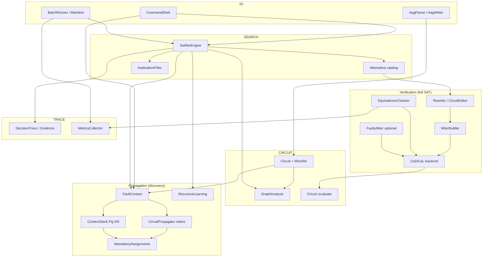

# SatRAR 論文級完整架構計畫

**目標論文：** Wu et al., ASP-DAC 2009 — *SAT-Controlled Redundancy Addition and Removal*  
**專案根目錄：** `satrar-cpp/`  
**文件版本：** 2026-11-24（稽核修訂）

**一致性狀態：** 見 `docs/SatRAR_Core_Consistency_Audit_2026-11-24.md`。現行程式為 **prototype**，多項測試 PASS **不**代表論文語意成立。

**實作順序（稽核後）：** M1 等價／fault oracle（16A–17）→ M2 論文案例（18–20）→ M3 學習與 batch（21–23）。Native BCP（原 Phase 22）**晚於** verifier／MA 修正。

---

## 1. 成功定義（什麼叫「論文級」）

| 維度 | 論文要求 | 本計畫驗收標準 |
|------|----------|----------------|
| **演算法語意** | Sec. II–IV：`MA(w_t)`、`MA(g_d)`、2WRAR、SRAR Wire/Gate、Figure 5/6 情境 | 固定 fixture（Fig. 1 `g6→g7`、Fig. 6 追蹤）的 MA 與候選集合 **與論文敘述一致**（允許變數命名不同，不允許語意偏差） |
| **推論引擎** | 電路結構 BCP + implication graph（QuteSAT 系思想） | **預設** `CircuitPropagator` 路徑；CNF+`implies` 僅作 `SATRAR_LEGACY_CNF=1` 對照 |
| **搜尋模式** | `2WRAR_L0/L1/L2`、`SRAR_Wire`、`SRAR_Gate`、`SRAR_Gate-Lrn`、`SRAR_Gate-Imp` | CLI + batch 可逐模式開模式開關；學習／filter 與論文 Section V 選項對齊 |
| **驗證** | 兩段 **good** CEC（golden≡added、added≡removed）皆 UNSAT 才 accept；**faulty miter** 作 Det(F) oracle（非 accept 條件） | Stage A/B 可信 UNSAT only；SAT on golden 表示 target 仍可偵測為預期 |
| **實驗** | Table I/II、Figure 7 口徑（#wire、#tar、#alt、#T、時間分開） | `results/` 可重現 TSV/CSV + 環境 manifest；ISCAS85/ITC99 與論文同前處理假設 **文件化** |

**非目標（第一版可延後）：** latch 時序電路、多輸出 fault 的完整 ATPG 整合、與 Berkeley ABC 內建 CEC 取代 CaDiCaL。

---

## 2. 現況與差距（相對論文）

```text
已有（工程可用）                    論文級缺口
─────────────────────────────────────────────────────────────
AIG + AagParser/Writer             結構化改線後 PO/符號/稀疏 ID 不變性測試
GraphAnalysis (dom, cycle)         PO-reachable dominator 與多 PO 匯合嚴格語意
FaultContext + CNF implies         多層 context（Fig. 5/6）、MA(g_d) 獨立快照
SatRarEngine (L0–L2, Wire, Gate*)  Gate 候選語意 + 套用；recursive learning
RarVerifier (2-stage CEC)          Faulty miter / exact fault test 路徑
Batch 腳本                         Table I/II 完整矩陣 + 超時/重試協定
CircuitPropagator (CNF 別名)       真正的 gate watching BCP

* Gate 目前為簡化 MA 啟發式，非完整 Fig. 5 決策樹
```

---

## 3. 總體架構（分層）



### 3.1 雙路徑原則（計畫 v2 契約）

| 路徑 | 輸入 | 輸出 | Solver |
|------|------|------|--------|
| **Discovery** | 單份電路 + fault context + 結構決策 | Wire/Gate 候選 + MA 證據 + trace | `CircuitPropagator`（內部可選 MiniSat 僅處理 learned clauses） |
| **Verification** | 兩份（或三份）電路 miter | SAT/UNSAT/Unknown + CE model | CaDiCaL |

Discovery **不得**用完整 CDCL 當 MA 預設；Verification **不得**用 `implies` 代替等價證明。

---

## 4. 模組規格（目錄 + 職責 + 主要型別）

### 4.1 `include/satrar/aig/`（不變核心，擴充編輯 API）

| 模組 | 新增/擴充 | 說明 |
|------|-----------|------|
| `Circuit` | `CircuitEditor` 或擴充方法 | `insertAndOnWire`, `bypassWire`, `substituteNode`, `sweepDead`, 保留 `aagVar` 分配策略 |
| `AagWriter` | 回歸測試 | 寫出後 `parse`  round-trip；PO/PI 順序不變 |

**驗收：** Fig. 1 fixture 三種電路（golden / wire-added / target-removed）byte-stable 或語意等價。

### 4.2 `include/satrar/analysis/`（論文核心）

#### 4.2.1 `Fault.hpp`（已有，補語意）

- `PinFault`：`WireRef` + `StuckAt`（target **receiving pin**）
- `DominatorOutputFault`：dominator AND 輸出 stuck
- 新增 `PropagationAssumptionSet`：記錄 **可證明必要** vs **啟發式** vs **需 exact test** 三態

#### 4.2.2 `ContextStack.hpp`（新建）

對應 Figure 5/6：

```text
Level 0 (permanent):  global circuit facts（常數、結構 clause 若走 CNF）
Level 1 (reversible): fault excitation/propagation (D)
Level 2+:             gate decisions (G), side-input trials, dominator switch
```

API 草案：

- `pushFaultContext(D)` / `popToSharedFrontier()`
- `snapshotMaWt()` → `MandatoryAssignments`
- `switchDominator(g_d)`：保留下游 **shared implications**（Fig. 6）
- `rollbackFaultContext()`：清 fault，保留 level 0

#### 4.2.3 `CircuitPropagator.hpp`（重寫為 native）

參考 QuteSAT / 論文電路 BCP：

| 子元件 | 職責 |
|--------|------|
| `GateWatcher` | 2-input AND：兩輸入 + 輸出 watching |
| `AssignmentStore` | 三元值 + reason（gate id / assumption / decision） |
| `ImplicationQueue` | 單向 BCP；記錄 `MandatoryAssignment` |
| `CircuitClause`（可選） | 結構學習 clause 的電路等價表示 |

**與 CNF 橋接：** `CnfEncoder` 僅用於（1）learned clause 合法性檢查（2）對照測試 `LegacyCnfPropagator`。

#### 4.2.4 `MandatoryAssignments.hpp`（擴充）

- 區分 `fromPropagation` vs `fromDecision` vs `fromFault`
- `snapshot()` / `restoreSnapshot()` 已有；加 **diff** 供 trace 輸出
- `complementaryOn(DimacsLiteral|CircuitLit)`：2WRAR 判準封裝

#### 4.2.5 `FaultContext.hpp`（重構為門面）

```cpp
class FaultContext {
  void setBackend(PropagationBackend); // Native | LegacyCnf
  MandatoryAssignments computeMaWt();
  MandatoryAssignments computeMaGd(NodeId dominator);
  bool pushDecision(CircuitDecision);
  bool propagate();
  void analyzeConflict(LearnedClause* out); // recursive learning
};
```

### 4.3 `include/satrar/rar/`（搜尋 + 改寫）

#### 4.3.1 `Alternative.hpp`

- `WireAlternative`：attach, source, complement, `evidenceLevel`, `MaEvidenceId`
- `GateAlternative`：`insertedAnd` 拓撲位置、side inputs、polarity
- `SubCircuitAlternative`（Theorem 3，Phase 次末）：子電路替換邊界

#### 4.3.2 `SatRarEngine.hpp`（模式矩陣）

| 模式 | 候選來源 | 論文章節 |
|------|----------|----------|
| `TwoWayRarL0` | MA(w_t) vs MA(g_d) 已相反之 literal，直接導出（無進一步學習） | Sec. II |
| `TwoWayRarL1` | 同上，**遞迴學習深度 1**（justified branch 交集） | Sec. II · Ex.4 |
| `TwoWayRarL2` | **遞迴學習深度 2** | Sec. II |
| `SrarWire` | Fig.5 兩步：已有反向 MA → MA(w_t)−MA(g_d) 差集試探 → 衝突得 wire，接到 **g_d** | Sec. III |
| `SrarGate` | 決策 + 反向 implication | Sec. III–IV |
| `SrarGateLrn` | + conflict-driven learning | Sec. IV |
| `SrarGateImp` | + implication filter | Sec. IV |

`SatRarOptions`：

- `enableLearning`, `enableImplicationFilter`, `excludeTargetDirectReceiverGates`（Section V 對照）
- `maxDecisionDepth`, `timeoutSearchMs`

#### 4.3.3 `ImplicationFilter.hpp`（新建）

- 輸入：候選 gate decision 集合
- 輸出：是否與已知 MA / dominator 相依、是否需跳過
- 與 `GraphAnalysis::wouldCreateCycle` 聯動

#### 4.3.4 `RecursiveLearner.hpp`（新建）

- 衝突時從 reason graph 回溯 **僅候選 decisions**
- 產出 `LearnedClause`（context literals + 永久結構 clause）
- 保證：**永久 clause ⊆ 原電路語意**（用 CNF entailment smoke 或小電路窮舉）

#### 4.3.5 `Rewriter.hpp` / `CircuitRewriter.hpp`

三階段電路（計畫契約 §6.6）：

1. `buildPatchedOnly`：只加候選（wire / AND）
2. `buildRemovedTarget`：在 (1) 基礎上去 target
3. `sweepAndValidate`

Gate 路徑必須與 Wire 一樣可 `write_aag` + reload。

#### 4.3.6 `RarVerifier.hpp`

- Stage A：golden ≡ patched（UNSAT）
- Stage B：patched ≡ removed（UNSAT）
- 可選 Stage C：**faulty miter**（target fault 下 PO 仍可區分 → 拒絕候選）
- 狀態機：`accepted` | `rejected` | `unverified` | `timeout` + 原因字串

#### 4.3.7 `DecisionTrace.hpp`（新建，Fig. 6 驗收）

- JSONL 或 columnar：每次 assume / propagate / rollback 的 literal、reason、level
- CLI：`trace_ma <fixture>` 輸出與論文 Fig. 6 逐步對照表

### 4.4 `include/satrar/sat/`（驗證端）

| 模組 | 擴充 |
|------|------|
| `MiterBuilder` | good/faulty 雙 miter；PI 對齊；變數命名空間隔離 |
| `EquivalenceChecker` | 多 PO XOR + OR；CE → `Circuit::evaluate` 回放 |
| `FaultyMiterBuilder` | stuck-at 注入在 miter 的 fault 側 |
| `CadicalBackend` | timeout、模型解析穩定化、版本 pinning |

`CnfEncoder`：Discovery 預設不再全量編碼；僅驗證 / learning 檢查使用。

### 4.5 `include/satrar/experiment/`（新建）

| 模組 | 職責 |
|------|------|
| `BenchmarkManifest` | 電路列表、hash、gate→AIG 轉換紀錄 |
| `TargetEnumerator` | #tar 定義（pin faults + 論文計數規則） |
| `BatchRunner` | 平行度、timeout、resume |
| `TableReporter` | Table I/II 欄位生成 |

### 4.6 `app/CommandShell`（命令對照）

| 命令 | 論文級行為 |
|------|------------|
| `fault_ma pin\|dom` | 輸出完整 MA + optional trace |
| `rar_l0\|l1\|l2` | 2WRAR |
| `rar_wire` / `rar_gate` / `rar_gate_lrn` / `rar_gate_imp` | SRAR 系列 |
| `rar_verify` | 三態結果 + 兩段時間 |
| `set_prop backend native\|cnf` | 切換推論後端 |
| `write_aag` | 三階段匯出 |

---

## 5. 關鍵資料流

### 5.1 SRAR Wire（discovery）

```text
set PinFault(w_t) → computeMaWt() with good/faulty excitation + propagation
for each g_d (PO-path postdominator chain, Fig.5 order):
  computeMaGd(g_d) on output fault
  collect literals in MA(w_t) vs MA(g_d) with opposite justified values
  SRAR_Wire: for literal ℓ in difference set:
      trial on MA(g_d); conflict attributable to ℓ → wire candidate at g_d with ¬ℓ
  SRAR L0: emit pairs already opposite without trial
  rollback shared frontier / switch dominator (Fig.6)
```

**非** bypass sibling cone scan（現行 `SatRarEngine` 路徑為錯誤診斷用 heuristic，Phase 19 移除或隔離）。

### 5.2 SRAR Gate（discovery）

```text
set PinFault(w_t)
  → computeMaWt()
  → decision tree over non-controlling side inputs (Fig. 5)
  → on reverse implication to target MA:
        build GateAlternative(decisions G, polarity)
  → on conflict:
        RecursiveLearner → permanent clause
        if enableImplicationFilter: prune candidates
```

### 5.3 驗證（acceptance）與 fault oracle

```text
Discovery 階段（每個 target）:
  Det(F) via good/faulty miter → UNSAT 則不可偵測，跳過

Acceptance（每個 candidate）:
  added   = buildAddedOnly(c)      // target 仍存在
  removed = buildRemovedTarget(c)    // 自 added 綁定 target stuck 再 sweep
  if CEC(golden, added)   != UNSAT → reject (SAT/Unknown/Timeout/BackendError)
  if CEC(added, removed)  != UNSAT → reject
  only dual UNSAT → accepted

Fault oracle 另列:
  Sat on golden+fault on added = target 仍偵測（設計預期），不作 reject 理由
```

---

## 6. 實作階段（稽核版 Phase 16A–23）

與 `docs/SatRAR_Core_Consistency_Audit_2026-11-24.md` §5 一致。

| Phase | 名稱 | 里程碑 |
|-------|------|--------|
| **16A** | CNF / miter / CEC / 狀態 / regression | M1 前置 |
| **16B** | x64 backend 可追溯 + 整合測試誠實 skipped/fail | M1 |
| **17** | Postdominator、cycle、good/faulty miter、exact MA | **M1** |
| **18** | `MaResult`、Fig.6 trace、incremental context | M2 前置 |
| **19** | 2WRAR L0 + SRAR_Wire（MA 比較） | M2 |
| **20** | added/removed + SRAR_Gate | **M2** |
| **21** | L1/L2 學習深度、conflict learning、filter | M3 前置 |
| **22** | Native gate BCP、Theorem 3 | P2 |
| **23** | Table I/II、Figure 7 batch | **M3** |

**下一任務：僅 16A**（候選搜尋暫不改）。

---

## 7. 測試金字塔

```text
L1 單元：Literal, Wire, GateWatcher, ContextStack, Learner
L2 論文 fixture：fig1_g6_g7, fig6_shared_backtrack, and_self, halfadder
L3 對照：native vs CNF MA 同一候選集（小電路）
L4 整合：rar_verify 全鏈 + write_aag round-trip
L5 回歸：aag_invariants 全 benchmarks（上限可配置）
L6 實驗：batch 子集 smoke（5 分鐘）+ nightly 全量
```

新增目錄建議：

```text
tests/fixtures/paper/
  fig1_g6_g7.aag
  fig6_tutorial.aag
tests/paper/
  test_fig6_trace.cpp
  test_fig1_candidates.cpp
```

---

## 8. 實驗重現協定（Section V）

### 8.1 計數定義（寫死在 `experiment/CountingRules.md`）

| 符號 | 定義 |
|------|------|
| `#wire` | **總 wire 數**（論文 Table I/II） |
| `#tar` | **可替換的唯一 target wire 數** |
| `#alt` | 這些 target 產生的 **alternatives 總數**（去重前／後需文件化） |
| `#T` | **discovery runtime**（秒）；另欄 `verify_ms`、`accepted_count` |

### 8.2 Manifest 欄位

`input_hash`, `aig_and_count`, `converted_from`, `mode`, `search_ms`, `verify_ms`, `solver_cadical_version`, `build_id`, `timeout`, `outcome`.

### 8.3 基準集

1. **開發：** EPFL combinational（現有 cap）
2. **論文：** ISCAS85 + ITC99（gate→AIG 步驟與計數差異記錄）
3. **對照：** 論文 Table I/II 行（允許 % 誤差門檻，**不可** 無法解釋的數量級偏差）

---

## 9. 技術決策（需實作前鎖定）

| # | 決策 | 建議 | 備註 |
|---|------|------|------|
| D1 | Discovery 預設後端 | Native `CircuitPropagator` | CNF 保留為對照 |
| D2 | Learned clauses | 永久 clause 入 MiniSat **或** 電路專用 clause store | 與論文「不破壞語意」一致 |
| D3 | Gate netlist → AIG | 文件化 abc/aigtocnf 流程；不宣稱與論文 gate 數 1:1 | manifest 記 `converted_from` |
| D4 | CaDiCaL 介面 | 維持 CLI + 可選 lib | Windows pin 版本 |
| D5 | 多 PO dominator | 結構定義寫入 `GraphAnalysis` 文件 | 避免與 ATPG 術語混淆 |
| D6 | Reconvergent fanout | 不能固定 side input 時標 `NeedsExactTest` | 呼叫 Stage C faulty miter |

---

## 10. 風險與緩解

| 風險 | 影響 | 緩解 |
|------|------|------|
| Native BCP 工期長 | 阻擋 Gate/Learning | Phase 17 只做 AND；Phase 19 前 2WRAR 可仍用 CNF 對照 |
| Table 數字對不齊 | 論文級宣稱失敗 | 分「語意復現」與「數字復現」；後者單獨 milestone |
| MiniSat `implies` 與 CDCL 語意差 | 假陽性 MA | Native 為準；CNF 僅 regression |
| Gate 改寫 sweep 錯 | CEC 通過但電路非法 | `Circuit::validate` + aiger 官方工具 cross-check |

---

## 11. 建議下一個 Cursor 任務

**只執行 Phase 16A**（見稽核 §6）：四則 CNF/miter regression → 修正常數與 `piMap` → CEC 狀態機與 tempfile 隔離。**不**改 fault／候選規則至 16A 驗收完成。

---

## 12. 文件維護

- 稽核：`docs/SatRAR_Core_Consistency_Audit_2026-11-24.md`
- 本檔：`docs/SatRAR_Paper_Level_Architecture_Plan.md`（架構總覽）
- 細節契約：合併進 `docs/Cursor_Composer_SatRAR_Plan_v2.md` §6
- 模組對照：`docs/source-map.md`
- 偏差紀錄：`docs/algorithm-notes.md`
- 狀態：`results/PHASE_STATUS.md`