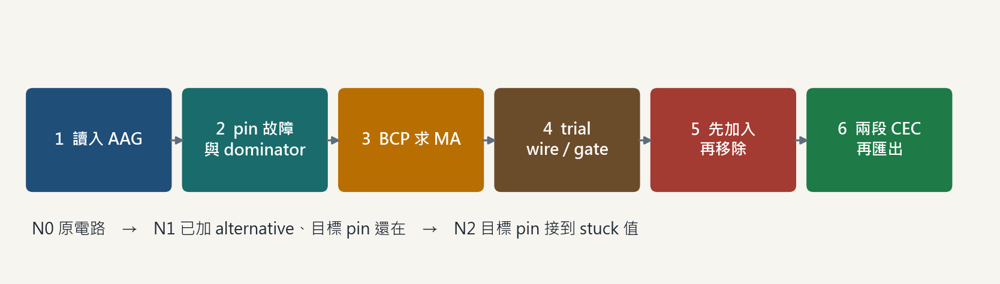
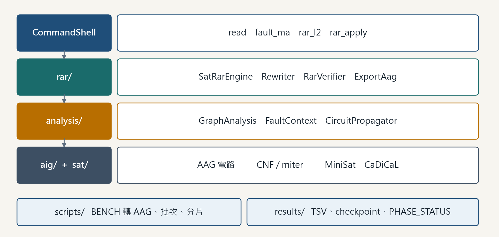
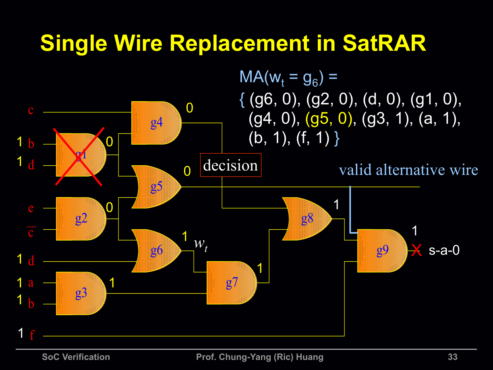
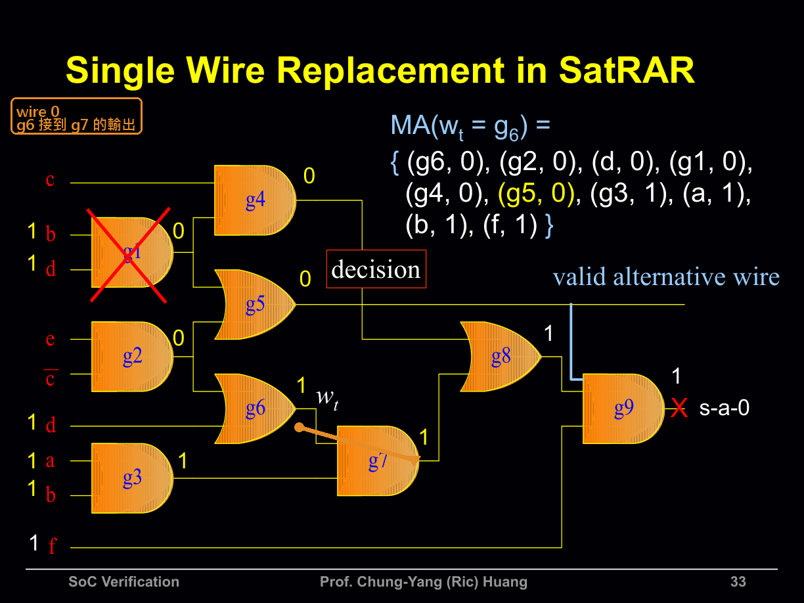
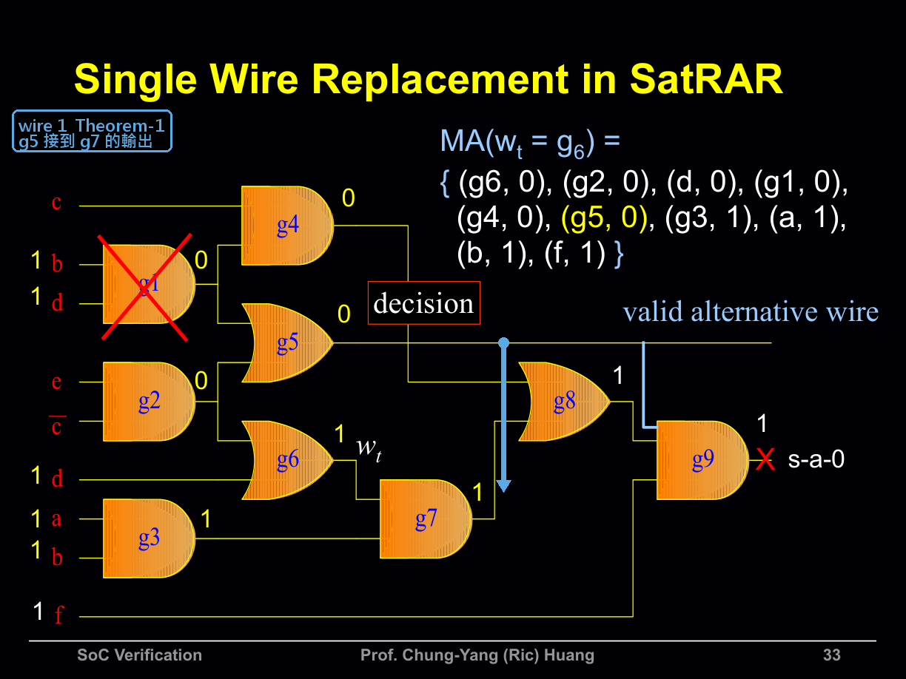
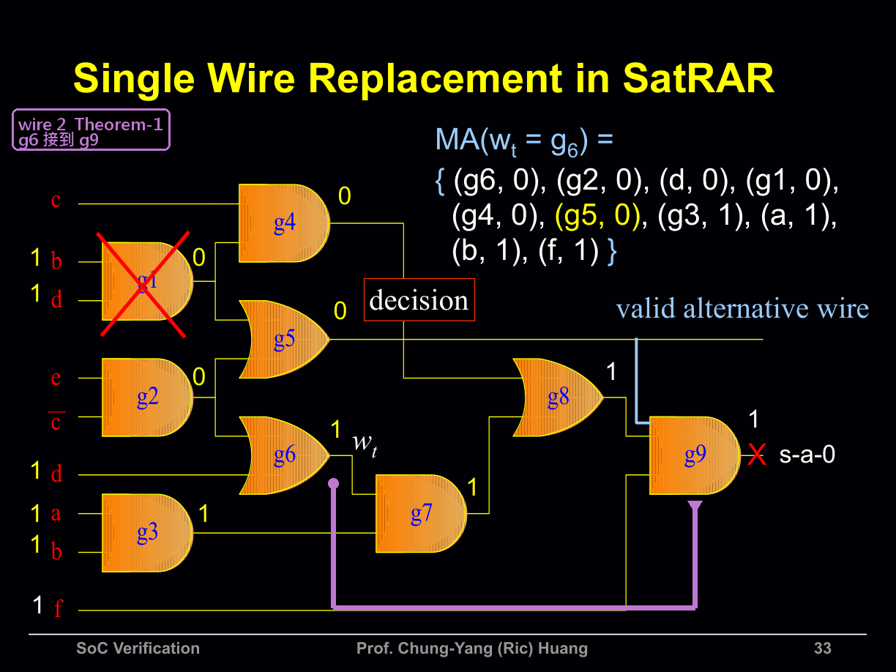

# SATRAR

B12203001陳陞
2026/11/25

---

# 先看整條流程

讀進電路，指定一根 pin 壞掉。程式先問：要抓到這個故障，電路上哪些值是逃不掉的。再沿著下游一定會經過的 gate，試著找一根條件線。找到之後先把線加上去，確認功能沒變，再把原來那根 pin 接到常數，再確認一次。兩次都過，才把改完的電路寫出去。

---

# 程式分成幾層

上面是你打的命令。中間三層負責找線、改線、證明。最下面是電路本身，以及拿來做傳播和證明的 SAT。批次實驗不在執行檔裡，是外面的 Python 腳本。

---

# 電路這一層在放什麼

一張 AIG 就是一堆二輸入 AND，加上輸入和輸出。反相不做成一顆 NOT，只記在線上：偶數是原相，奇數是反相。

讀檔的人把 ASCII AIGER 收成這張圖，也檢查它沒有環。寫檔的人再把它存回去。電路自己會做三件日常的事：照拓樸模擬、換掉某一支 pin、把某個 gate 的所有下游都改接到新的輸出。後面的改線就是靠後面這兩件事。

---

# 線和 gate 在程式裡怎麼認

一根線有兩端：從誰出來、進誰的第幾支 pin。Figure 1 裡，g6 進 g7 的第 0 支，所以命令寫 `13 0`。13 是 g7 的變數編號。

`source_raw=23` 這種數字是 AIGER 的 literal。23 是奇數，所以是變數 11 的反相，在這張圖上就是 g5。`attach=15` 則是 gate 的變數編號，15 就是 g9。一個是「接上去的訊號」，一個是「接到誰的輸出上」，不要看成同一個東西。

---

# 圖上在找誰

從目標 pin 往輸出走，有些 gate 是每條路都會經過的。這些就是 dominator。新線只准接到這種 gate 上，而且不能繞回自己，否則電路會成環。

Figure 1 裡，g7 自己是最近的一個，g9 是更下游的一個。講義後面談的 gd，就是這些點。

---

# 故障和必要賦值

故障只改一支 pin。g6 進 g7 的 stuck-at-1，意思是故障電路裡這一支被固定成 1，其他用到 g6 的地方仍看原來的 g6。

要在好電路上把這個故障激發出來，g6 必須是 0。接著傳播會再推出一連串逃不掉的值，這包值叫 mandatory assignment，簡稱 MA。報出來的每一個都必須真的必要。沒推出來的，不代表不存在，只代表這次的傳播還沒走到那麼深。

---

# 傳播器在做 SAT 的哪一部分

它不做「把整題丟給 MiniSat」。它做的是 SAT 裡真正用來推值的那一段。

電路先編成子句。然後：

- 已知一些值，就一直推，直到不能再推。
- 想試一個假設，就加一層，不行就整層退回。
- 推到矛盾，就沿著理由找出是哪些假設造成的，把這件事記成一條新規則。下一回立刻用得上。

所以搜尋是有 SAT 的味道的：傳播、決策、回溯、學習。只是決策由 RAR 來選，不是 solver 自己亂分支。

---

# 搜尋引擎怎麼挑線

對一個目標，它一個 dominator 一個 dominator 看。SatRAR 會在這個接點上試目標側的一個必要值。試到矛盾，這根線就可以接上去。這是單線，規則叫 Theorem-1。

再把幾個這樣的值組成 AND，就是 gate。再加上一個 OR，就是 sub。

試太多次就停，已經找到而且證明完成的候選會留下。某個故障一推就矛盾，代表那裡本來就多餘，記一筆，但不把它當成一條新線。

---

# SatRAR 的找法

今天不講 2-way RAR。

`rar_wire` 出單線。在 dominator 上試一個值，推到矛盾就能接。
`rar_gate` 把幾個值組成 AND，也會學習，也會跳過已經蘊含的試探。
`rar_gate_nolearn` 不記新規則。`rar_gate_nofilter` 不跳過，所以通常最慢。
`rar_sub` 才找 AND 再加一個 OR。

---

# 找到之後怎麼改、怎麼證明

改線分兩步，不能併成一次。

第一步，在 dominator 的輸出上加一顆 AND，另一支輸入就是候選的那根線。原來的目標 pin 先留著。這時功能必須和原電路一樣。

第二步，把目標 pin 接到它的 stuck 值，再化簡。功能還是必須一樣。

兩次都是用 miter 問 CaDiCaL。UNSAT 才算等價。SAT 而且反例真的能讓某個輸出不同，才算拒絕。逾時、solver 壞掉、模型對不上，都叫作還不能確定，這種結果不會寫出檔案。

寫檔也分兩步：先寫到旁邊的暫時檔，從磁碟重讀再證明一次，才換上正式檔名。

---

# 兩個 SAT solver 各管一件事

搜尋當下的傳播，是我們自己的傳播器。

MiniSat 只在你要「精確」的時候出場，回答這個故障到底看不看得出來，以及某一條 MA 是不是真的被偵測條件蘊含。

CaDiCaL 只負責改線前後的等價。它的時間不算在論文的 `#T` 裡。`#T` 只算找候選的時間。

論文自己用的是 QuteSAT 那種直接在 gate 上做的 SAT，機器是 Linux、Xeon。我們這份是 Windows 上的 AIG。秒數不能拿來相除。

---

# 命令列可以做什麼

在 PowerShell 啟動 `satrar.exe` 之後，提示字元變成 `>`。從這裡開始只打它的命令。

`read` 載入一張 AAG。`stats`、`inputs`、`outputs` 看這張圖有多大。`fault_ma` 印某個 pin 或某個 dominator 的 MA。

`rar_wire`、`rar_gate`、`rar_gate_nolearn`、`rar_gate_nofilter`、`rar_sub` 是搜尋。後面三個數字是 gate 變數、pin、sa0 或 sa1。

`rar_verify` 把剛列出的候選都拿去證明。`rar_apply` 挑其中一筆，證明通過才寫出改完的 AAG。`help` 看清單，`quit` 離開。

---

# 這些命令不要打在 `>` 裡面

編譯、跑全部測試、跑論文那 12 張 BENCH，都是 PowerShell 的事。提示字元要是 `PS`。

`cd`、`python`、`ctest` 打進 satrar 的 `>`，它只會回 unknown command。

論文電路是 `.bench`。批次腳本會先轉成 AIG 再搜。互動殼只能直接讀 `.aag`。

---

# SatRAR 單線：講義原圖

命令是 `rar_wire 13 0 sa1`。藍線是講義自己畫的：在 g9 上試 g5，推到矛盾，所以 g5 可以接到 g9。這是 `candidate[3]`，Theorem-1。

---

# `rar_wire` 這次的四條

0. g6 接到 g7 的輸出。兩邊本來就相反。
1. g5 接到 g7 的輸出。Theorem-1。
2. g6 接到 g9。Theorem-1。
3. g5 接到 g9。上一頁的藍線。Theorem-1。

0 和 1 接在目標 gate 自己身上，論文做表時不計。

---

# candidate[0]

---

# candidate[1]

---

# candidate[2]

---

# candidate[3]

上一頁講義的藍線就是這一筆。`attach=15`，`source_raw=23`。
`rar_apply 3` 通過時印 `verified_equivalent`。新輸出是 g9 AND g5，然後才能把 g6 進 g7 的那支 pin 接到常數。

---

# 還沒對上的地方

Figure 1 這一條已經對上了。論文 Table I、Table II 的顆數還沒有對上。

原因很具體。論文掃的是原來的 gate 網表，我們掃的是拆成二輸入 AND 的 AIG。C432 論文有 336 根線，我們搜了 424 個 AIG pin。同一套定義，不同的圖，數字就不會一樣。

時間也還沒對上。論文是 QuteSAT、Linux、Xeon。我們是這顆傳播器加 CaDiCaL，在 Windows 上。`#T` 只能跟自己的模式比。

大電路 b14 以後還沒跑完。原始 gate 不拆開的那一版，也還沒做。
